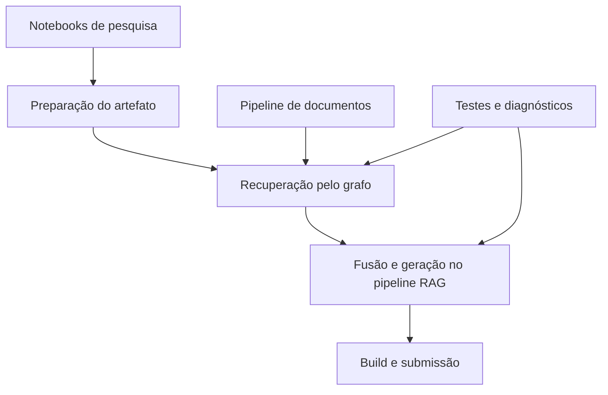

# Implementações

Esta pasta detalha os componentes implementados. A introdução menos detalhada
está na [visão técnica](../technical-overview.md).

| Documento | Conteúdo |
| --- | --- |
| [Pipeline RAG](rag-pipeline.md) | PDF, chunking, fontes, BM25, embeddings, RRF, contexto e geração |
| [Preparação do KG](kg-data-preparation.md) | Exportações dos notebooks, conversão, esquema, auditoria e proveniência |
| [Recuperação pelo grafo](graph-retrieval.md) | Entidades, postings, adjacência, filtros, limites, pontuação e rastreabilidade |
| [Build e validação](build-and-validation.md) | Ambiente, testes, diagnósticos, ZIP e limites de recursos |

Ao alterar um componente, atualize seu documento, os parâmetros, os exemplos
e os fluxos/diagramas correspondentes. Resultados medidos ficam em `docs/reports/`, com identificação
do cenário e das limitações.
