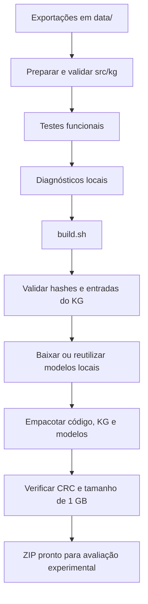

# Ambiente, testes, diagnósticos e submissão

[Visão geral](../technical-overview.md) · [Índice de implementações](README.md)

## Ambiente e dependências

O ambiente local usa Python 3.12. As versões da avaliação estão em
[requirements-participant.txt](../../starter-kit/IEEE-CIS-DSQA-Starter-Kit/requirements-participant.txt).
Somente a preparação do Turtle requer
[requirements-kg.txt](../../tools/requirements-kg.txt). Por exemplo, com uv
disponível, um ambiente novo pode ser preparado assim:

```bash
uv venv --python 3.12 .venv
uv pip install --python .venv/bin/python \
  -r starter-kit/IEEE-CIS-DSQA-Starter-Kit/requirements-participant.txt \
  -r tools/requirements-kg.txt
```

O KG não requer dependências adicionais na avaliação. Ele carrega JSONL e
opera seus índices com a biblioteca padrão, em CPU.

## Fluxo de validação e build



```bash
.venv/bin/python tools/prepare_kg.py
HF_HUB_OFFLINE=1 TRANSFORMERS_OFFLINE=1 \
  .venv/bin/python -m unittest discover -s tests -v
```

| Arquivo de testes | O que verifica |
| --- | --- |
| [test_retrieval.py](../../tests/test_retrieval.py) | BM25, embeddings simulados, alinhamento de fontes, RRF, contexto, cache e candidato exclusivo do grafo |
| [test_kg.py](../../tests/test_kg.py) | Aliases, ambiguidades, identidade canônica, postings, integridade e conversão do artefato |
| [test_graph_retrieval.py](../../tests/test_graph_retrieval.py) | Um salto, direções, duplicatas/ciclos, filtros, pesos, limites, caminhos compartilhados e configuração |

Os testes unitários não carregam OLMo nem dependem de GPU. A extração de PDFs e
os modelos usados nos testes do pipeline são simulados. Isso valida o código,
sem medir a acurácia ou a execução completa da competição.

## Diagnósticos reproduzíveis

O script [profile_kg.py](../../tools/profile_kg.py) lê as perguntas públicas,
sem usar suas respostas de referência, e escreve JSONs em `docs/reports/`:

```bash
# Reconhecimento de entidades, sem indexar um corpus:
.venv/bin/python tools/profile_kg.py

# Grafo real, um chunk artificial por label de entidade:
.venv/bin/python tools/profile_kg.py --mode graph --synthetic-label-chunks

# Grafo real, chunks extraídos de documentos disponíveis localmente:
.venv/bin/python tools/profile_kg.py --mode graph --chunks caminho/chunks.jsonl \
  --output docs/reports/kg-corpus-report.json
```

O JSONL de chunks deve conter `{"text": "passagem", "chunk_id": "arquivo.pdf#0"}`
por linha. `chunk_id` é opcional; a posição no arquivo é o ID interno. Esse modo
mede o índice de entidades/grafo sobre o texto fornecido, não a etapa Docling.

Os relatórios registram configuração, hashes das exportações, tempos de carga,
construção de índices e consultas, pico RSS do processo Linux e traces das
expansões. Em modo `graph`, comparam os IDs recuperados por menções e pelo grafo.
O pico RSS engloba todos os objetos do processo de diagnóstico; não é a memória
exclusiva da função de expansão nem a memória GPU.

O [relatório do grafo](../reports/kg-graph-report.json) fornecido usa chunks
sintéticos, construídos das próprias entidades. Novos chunks nesse cenário
demonstram funcionamento da expansão, sem indicar relevância ou ganho de recall.
Alguns vizinhos são pouco pertinentes à pergunta. Os tempos não substituem
uma medição do pipeline completo na H100.

## Build e variantes

[src/build.sh](../../src/build.sh) aceita:

| Variável | Padrão | Efeito |
| --- | --- | --- |
| `INCLUDE_KG` | `1` | Incluir o KG validado; `0` gera pacote sem artefato KG |
| `REUSE_MODELS` | `0` | `1` reutiliza os diretórios de modelos presentes |

```bash
source .venv/bin/activate
REUSE_MODELS=1 ./src/build.sh
```

O script verifica se os dados originais e aliases locais ainda correspondem
ao manifesto. Se estiverem diferentes, pede uma nova preparação. Inclui
`main.py`, `kg_retrieval.py`, quatro arquivos do KG, Docling layout e MiniLM.
Notebooks, dados brutos, ferramentas de preparação e dependências de
desenvolvimento ficam fora do pacote.

A saída é `hybrid_rag_submission.zip`, substituída em cada build. O script
verifica CRC e rejeita arquivos maiores que 1.000.000.000 bytes. A quantidade
de entidades e arestas não muda com a nova exploração; o custo adicional é
construir adjacências em RAM e consultar os postings em CPU.

`KG_MODE` controla a **inferência**, não altera o código dentro do ZIP. O padrão
do código é `graph`; em execução local, `KG_MODE=mentions` ou `KG_MODE=off`
permitem comparar variantes. Definir `KG_MODE=mentions` apenas ao executar o
build não faz esse valor persistir no avaliador. `INCLUDE_KG=0` gera um ZIP sem
KG, que usa os dois canais mesmo com o modo padrão.

Para comparar variantes, mantenha corpus, modelo, pergunta e orçamento de
contexto iguais. Use processos separados para medições de RAM. É necessário
anotar evidências relevantes para medir recall/MRR e avaliar as respostas para
medir correção. Qualquer conclusão sobre melhoria ou conformidade com os 60
minutos depende desses experimentos completos.
