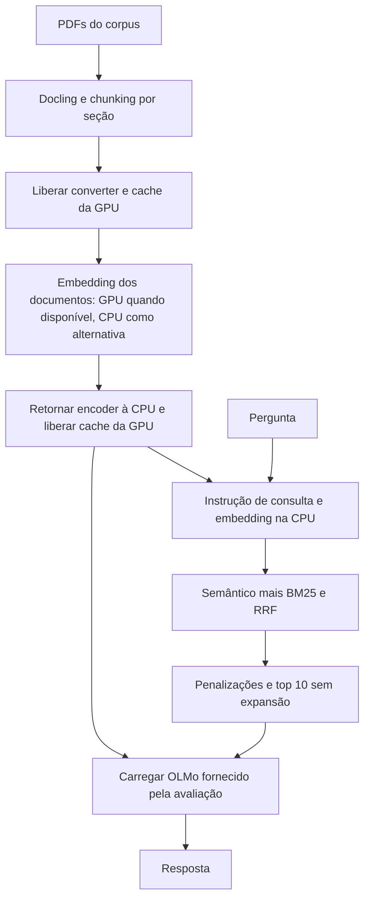

# Modelos de embedding, prompts e custo de execução

[Visão técnica](../technical-overview.md) · [Índice de implementações](README.md)

O embedding representa perguntas e trechos para a busca semântica. A troca do
modelo exige recalcular **ambos** os lados; o índice BM25 continua recebendo o
texto original. A comparação de 08/11 inclui MiniLM e dois modelos BGE, mantendo
corpus, chunking, perguntas, pesos e seleção de contexto iguais.

## Modelos e limite de entrada

| Modelo | Parâmetros | Dimensões | Limite usado |
| --- | ---: | ---: | ---: |
| all-MiniLM-L6-v2, controle local | aproximadamente 22,7 milhões | 384 | 256 tokens |
| BAAI/bge-small-en-v1.5 | 33.360.000 | 384 | 512 tokens |
| BAAI/bge-base-en-v1.5 | 109.482.240 | 768 | 512 tokens |

Os limites e a instrução de recuperação do BGE são documentados pelo
[publicador](https://huggingface.co/BAAI/bge-base-en-v1.5). O limite de 512 não
elimina todo truncamento: parágrafos e blocos matemáticos preservados pelo
chunking podem ultrapassá-lo. O limite do embedding é independente do orçamento
de contexto do OLMo. Aumentar o número de parâmetros por si só não aumenta o
comprimento aceito.

## Preparação offline e identificação dos pesos

[`tools/prepare_embedding_model.py`](../../tools/prepare_embedding_model.py)
resolve a revisão do modelo, baixa apenas os arquivos necessários no formato
nativo e salva um SentenceTransformer local. Nenhuma dependência nova é
instalada. A revisão exata, quantidade de parâmetros, dimensão, limite, prompts
e hashes de cada arquivo ficam em `embedding-manifest.json`.

```bash
.venv/bin/python tools/prepare_embedding_model.py \
  --model-id BAAI/bge-base-en-v1.5 \
  --output .cache/embedding-models/bge-base-en-v1.5
```

`--revision` permite fixar uma revisão específica. `--replace` prepara a nova
cópia antes de substituir um diretório existente. `--verify-only` verifica
arquivos e identidade sem rede nem carga de modelos. Os arquivos incluem apenas
um conjunto de pesos de embedding; versões ONNX/OpenVINO desses pesos não são
adicionadas. As duas versões do layout Docling são uma escolha separada do build.

O build aceita `EMBED_MODEL_ID` e verifica o manifesto ao reutilizar o modelo.
Ele prepara o modelo selecionado se a cópia existente não corresponder. Isso
evita que uma reconstrução volte silenciosamente ao MiniLM.

## Instruções de consulta

O BGE usa a instrução `Represent this sentence for searching relevant passages: `
antes da pergunta. Os documentos recebem seu texto original. A instrução é
salva em `config_sentence_transformers.json`, dentro do próprio modelo, para
acompanhar os pesos no ZIP.

[`src/embedding.py`](../../src/embedding.py) centraliza os dois papéis:

- `encode_queries`: aplica somente a instrução de consulta.
- `encode_documents`: aplica a instrução de documento, se houver; neutraliza um
  prompt padrão de outro papel para impedir que a instrução de consulta vaze.
- `embedding_inputs`: reproduz o texto que será tokenizado para a auditoria.

Main, runner e executor de grades usam o mesmo contrato. Modelos sem prompts,
como o controle MiniLM, conservam a chamada original de codificação. Prompts e
limites fazem parte dos arquivos JSON usados no fingerprint do modelo. Assim,
mudanças nesses parâmetros invalidam os embeddings em cache. O fingerprint
aceita modelos dentro de `.cache/`, ignorando somente subdiretórios de cache
internos ao modelo.

## Dispositivo e ciclo de memória na submissão



O batch de documentos é oito. O modelo de embedding e os vetores não permanecem
na GPU durante a geração; as consultas são codificadas em CPU. A devolução à CPU
ocorre em `finally`, inclusive se a codificação falhar. Isso reduz competição
por VRAM com o OLMo 32B. Os modelos de resposta não são carregados pelo runner.

Os benchmarks históricos foram medidos em CPU com quatro threads. O diagnóstico
posterior confirmou a RTX 4050 de 6 GiB e uma operação real de tensor CUDA
fora do sandbox. Dentro do sandbox, CUDA estava inacessível. Isso não é uma
medição de throughput na H100. O tempo oficial completo inclui conversão, índices
e geração.

Os JSONs locais agora usam `embedding_device=auto`. O runner mantém o encoder
no dispositivo escolhido para as consultas, pois não carrega OLMo. `docling_device`
pode ser configurado separadamente e fica em CPU nos presets locais. Caches de
vetores evitam nova codificação de documentos; por isso pouco uso da GPU é
esperado em varreduras quentes. O produto de vetores NumPy continua em CPU.

## Auditoria e comparação local

```bash
CUDA_VISIBLE_DEVICES='' HF_HUB_OFFLINE=1 TRANSFORMERS_OFFLINE=1 \
  .venv/bin/python tools/run_retrieval.py \
  --config experiments/configs/pipeline.json \
  --embed-model .cache/embedding-models/bge-base-en-v1.5 \
  --no-continuity --variants dense hybrid \
  --output experiments/runs/SEU_RUN
```

O runner salva em `config.json` o limite, dimensão e prompts do encoder; os
chunks registram tamanho e truncamento. `query-embedding-audit.json` registra
os tokens de cada pergunta **incluindo a instrução**, o limite e se houve corte.
`summary.json` inclui contagem de chunks e perguntas truncados. Os tempos de
documentos e consultas ficam separados de extração, carga e exportação.

Para comparar custo, é necessário distinguir hits de cache de texto e de
embeddings. O benchmark de 08/11 reutilizou o Markdown dos mesmos PDFs e usou um
cache novo de vetores, calculando uma vez os embeddings completos de cada modelo.
O controle MiniLM e o ZIP anterior foram preservados fora do pacote final.

## Verificações

Os testes de [`tests/test_embedding.py`](../../tests/test_embedding.py) verificam
papéis de prompts, auditoria, identidade do cache e integridade dos arquivos.
Os testes do pipeline verificam que o encoder retorna à CPU e que o contexto
preserva os dez candidatos selecionados, sem introduzir vizinhos.

Os resultados de relevância são estimados por documento. A seleção do encoder
também deve considerar as passagens recuperadas, pois uma métrica alta por
artigo não garante o trecho certo. A análise e os resultados medidos ficam no
[relatório da comparação](../reports/embedding-comparison-2026-11-08.md).
