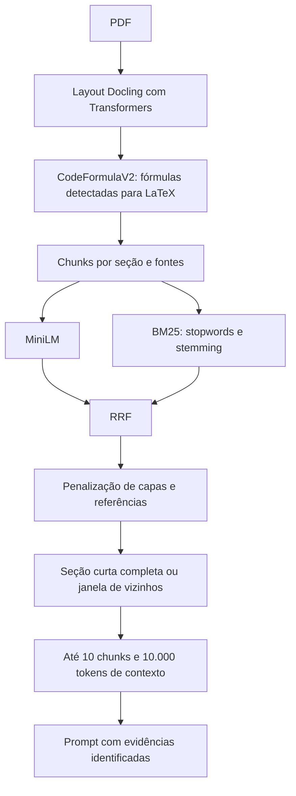

# Continuidade de evidências e reconhecimento de fórmulas

[Visão técnica](../technical-overview.md) · [Pipeline](rag-pipeline.md)

Implementação: [evidence.py](../../src/evidence.py),
[documents.py](../../src/documents.py), [retrieval.py](../../src/retrieval.py)
e [run_retrieval.py](../../tools/run_retrieval.py).
A submissão usa **hybrid**: semântico + BM25; o KG permanece opcional e fora do
ZIP padrão. Não foi acrescentado um reranker neural.

**Estado da candidata de 08/11:** o chunking por seção e as penalizações estão
ativos. A expansão automática de vizinhos e o reconhecimento de fórmulas estão
desativados; as seções abaixo documentam esses componentes opcionais. O encoder
agora é selecionado por artefato local, conforme
[Modelos de embedding](embedding-models.md).



## Chunking e identificação de seções

`section_chunks()` agrega parágrafos com alvo de 800 caracteres e sobreposição
máxima de 150 caracteres. Um título Markdown inicia um novo chunk e impede
sobreposição com a seção anterior. Um título isolado pode permanecer junto ao
primeiro parágrafo, ainda que esse bloco supere o alvo. Parágrafos longos não
são cortados arbitrariamente para atingir o tamanho.

Blocos `$$...$$`, `\\[...\\]` e ambientes `equation`, `align`, `gather` e
`multline` são preservados mesmo com linhas em branco. Blocos de código cercados
por crases/tildes também permanecem juntos. A cauda de overlap não é copiada
quando pertence a uma fórmula ou código estruturado. Uma fórmula muito longa
pode continuar maior que o orçamento de chunk; o empacotamento final tem um
limite independente de tokens.

`chunk_sources()` guarda ID do documento e do chunk, posição local, seção,
identificador de seção, caminho de títulos e `content_kind`. O identificador
separa ocorrências de títulos iguais dentro de um documento. Texto sem seção
identificada não recebe expansão automática. Esses identificadores dependem do
chunking: os novos chunks não devem receber anotações antigas apenas por
coincidência do sufixo numérico.

## Penalização após RRF

O score final de uma âncora é:

```text
score_ajustado(chunk) = score_RRF(chunk) × fator(chunk, pergunta)
```

| Tipo | Fator padrão | Regra |
| --- | ---: | --- |
| Corpo | 1,0 | Conteúdo não classificado nas outras categorias |
| Referências | 0,5 | Título de seção reconhecido como referências/bibliografia |
| Capa/autoria | 0,7 | Bloco inicial curto, só título ou com sinais de afiliação/e-mail, sem resumo/introdução/prova |

São heurísticas conservadoras, não classificadores treinados. Abstracts e texto
substantivo não são tratados como capa só por estarem no começo. Não há exclusão
permanente: uma pergunta explicitamente sobre autores, título, afiliação ou
referências suspende a penalização correspondente. Scores brutos continuam
rastreáveis no runner; os fatores ainda não foram otimizados por acurácia.

## Expansão por seção/vizinhança

Âncoras são visitadas na ordem de score ajustado. Para uma âncora:

- Se a seção tem até seis chunks, tenta-se incluir a seção completa.
- Em seção maior, usa-se um chunk anterior e até três posteriores.
- Nunca se cruza documento ou identificador de seção.
- Cada bloco é apresentado na ordem original da fonte, sem duplicar IDs já
  selecionados. A âncora é preservada quando restam poucas posições.
- A seleção termina em dez chunks no padrão; o orçamento de 10.000 tokens é
  aplicado depois, pelo tokenizer da LLM.

Os vizinhos são evidências de continuidade, não resultados de uma nova busca.
Um vizinho fora da união de candidatos do RRF tem score nulo no exportador;
isso é apresentado como `—` nas tabelas de revisão. `selection_role` distingue
candidatos entre as âncoras top-k de vizinhos acrescentados. A posição final
pode, por isso, não ter scores decrescentes: a ordem dentro do bloco preserva a
fonte. Se uma seção grande começa com conteúdo pouco específico, ainda pode
haver espaço consumido por passagens pouco úteis; essa é uma hipótese a avaliar.

## Fórmulas offline

O Docling 2.127.0 usa `do_formula_enrichment=True` com o preset CodeFormulaV2,
engine Transformers, SDPA e compilação desativada. O limite é de 1.024 tokens
por fórmula. Em CPU usa FP32; no caminho automático da submissão usa BF16,
adequado à H100. A etapa de conversão termina antes de carregar a LLM de
resposta; o conversor é liberado e o cache CUDA é limpo nesse ponto.

Os pesos públicos são fixados na revisão
`ecedbe111d15c2dc60bfd4a823cbe80127b58af4` de
[docling-project/CodeFormulaV2](https://huggingface.co/docling-project/CodeFormulaV2).
`prepare_formula_model.py` verifica o SHA-256 dos pesos e gera um manifesto de
arquivos. O build inclui processador/tokenizer/configurações junto aos pesos,
com caminhos locais. O modelo produz texto LaTeX e não depende de uma instalação
externa de LaTeX. OCR geral e reconhecimento de estrutura de tabelas continuam
desativados: não foram solicitados nesta implementação.

O reconhecimento depende de regiões que o layout identifica como fórmula;
não é garantia de reconstrução de toda expressão inline, de exatidão matemática
ou de compilação do LaTeX. Expressões longas podem atingir o limite por fórmula.
Os símbolos e números reconhecidos precisam ser comparados ao PDF, sobretudo
antes de atribuir melhora de respostas a esta etapa.

## Configuração local e ablações

O [pipeline.json](../../experiments/configs/pipeline.json) usa somente `hybrid`
por padrão. Para ativar os componentes opcionais em uma cópia do JSON:

```json
{
  "formula_enrichment": true,
  "continuity": true,
  "penalize_metadata": true,
  "reference_weight": 0.5,
  "front_matter_weight": 0.7,
  "neighbors_before": 1,
  "neighbors_after": 3,
  "small_section_chunks": 6
}
```

`top_k` controla o total de chunks exportados no runner. Na submissão, os
valores são escolhidos em `src/pipeline.json` e validados em `PipelineConfig`;
`EvidenceConfig` define a seleção. BM25 usa `k1=1.2`, `b=0.75`, stopwords e
stemming, alinhados à configuração atual. Exemplos de ablação:

```bash
.venv/bin/python tools/run_retrieval.py --config experiments/configs/pipeline.json
.venv/bin/python tools/run_retrieval.py --config experiments/configs/pipeline.json \
  --no-continuity --no-penalize-metadata
.venv/bin/python tools/run_retrieval.py --config experiments/configs/pipeline.json \
  --no-formula-enrichment
```

Os flags explícitos prevalecem sobre o JSON. A configuração da extração participa
da chave de cache: não se deve reaproveitar Markdown produzido sem fórmulas
como se tivesse sido enriquecido. Embeddings são cacheados pelo texto resultante.
As grades usam a mesma seleção de evidências do runner. Para reproduzir
experimentos anteriores também é preciso preservar a versão anterior do
chunking, não apenas desligar os três flags.

## Validação e limites da submissão

[test_evidence.py](../../tests/test_evidence.py) cobre limites de seção,
fórmulas, hierarquia, classificações, pesos, exceções por pergunta, vizinhança,
deduplicação e retenção da âncora. Há também testes de integração com o pipeline
local e de montagem do contexto.

Um teste real offline na página 10 de AI-007 recuperou as duas desigualdades da
construção de Y em LaTeX, sem `formula-not-decoded`, em aproximadamente 19,84 s
na CPU local (incluindo carregamento dos modelos nessa conversão). Esse tempo
não prevê o tempo do corpus completo na H100 e não é uma medição de acurácia.
O reconhecimento ainda preservou uma quebra `\\\\` ao final de uma fórmula,
reforçando que saída reconhecida não é validação matemática ou tipográfica.

O ZIP inclui somente o layout Transformers; a cópia ONNX redundante fica fora.
O modelo de fórmulas acrescenta aproximadamente 640 MB de arquivos brutos,
mas a primeira construção comprimida ficou em cerca de 746 MB. O build valida
CRC, presença de artefatos e o limite decimal de 1 GB antes de substituir o ZIP
anterior. Não foi executada a geração completa com OLMo 32B na H100: o limite de
60 minutos e a melhora nas respostas ainda exigem medição no ambiente oficial.
