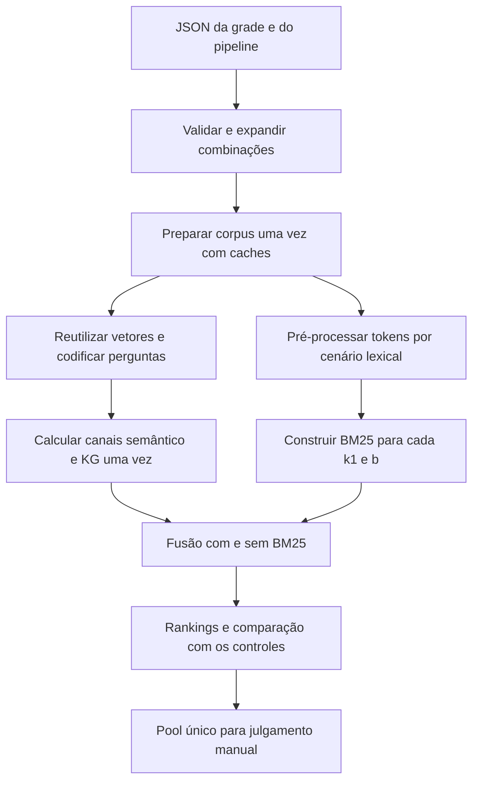
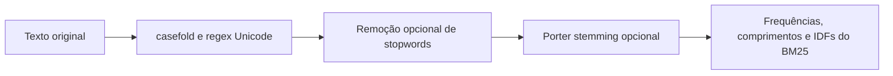

# Configuração e execução de grades de experimentos

[Visão geral](../technical-overview.md) · [Índice de implementações](README.md)

Implementações: [run_experiments.py](../../tools/run_experiments.py),
[configuration.py](../../tools/configuration.py) e [lexical.py](../../src/lexical.py).
O runner de uma configuração continua sendo
[run_retrieval.py](../../tools/run_retrieval.py).

## Fluxo de execução



## Arquivos editáveis

| Arquivo | Parâmetros |
| --- | --- |
| [bm25-grid.json](../../experiments/configs/bm25-grid.json) | Pré-processamento, listas de `k1` e `b`, epsilon, controles e variantes |
| [pipeline.json](../../experiments/configs/pipeline.json) | Entrada, embedding, cache, dispositivo, batch, threads, chunking, pesos e profundidades |
| [graph.json](../../experiments/configs/graph.json) | Campos de `GraphConfig` |

O arquivo do pipeline é um objeto JSON plano com os nomes dos argumentos, usando
underscore: `chunk_size`, `bm25_k1`, `bm25_stopwords` etc. Tipos, opções e limites
são os mesmos da CLI. Chaves desconhecidas produzem erro. Caminhos no arquivo
são resolvidos a partir da raiz do repositório; caminhos absolutos são aceitos.

Flags na linha de comando substituem os valores do arquivo. Por exemplo:

```bash
.venv/bin/python tools/run_retrieval.py --config experiments/configs/pipeline.json \
  --bm25-k1 0.75 --bm25-b 1 --bm25-stopwords --no-bm25-stemming
```

Os parâmetros do grafo vêm de `graph_config` quando esse arquivo é informado;
caso contrário, o runner mantém o suporte a `KG_GRAPH_*`.

## Pré-processamento lexical

O processamento é aplicado **igualmente aos chunks e às perguntas**, antes de
calcular frequências, comprimentos e IDFs. A ordem é:



| Cenário | Stopwords | Stemming |
| --- | --- | --- |
| `normalized` | Não | Não |
| `stopwords` | Sim | Não |
| `stemming` | Não | Sim |
| `stopwords_stemming` | Sim | Sim |

A normalização mantém o comportamento original: `casefold()` e regex `\w+`.
Stopwords usam a lista inglesa integrada do scikit-learn, com 318 termos na
versão instalada. Stemming usa `PorterStemmer.NLTK_EXTENSIONS`, em inglês, com
cache limitado das transformações. Nenhum corpus NLTK é baixado.

O texto original é preservado nos chunks, embeddings, KG e relatórios. Só o
canal lexical usa os tokens transformados. Stemming não é lematização e pode
unir palavras indevidamente; remoção de stopwords pode eliminar termos úteis,
inclusive negações. As quatro opções são hipóteses para comparação.

`preserve_words` permite proteger palavras, por exemplo `["no", "not", "nor"]`.
O padrão da grade é `[]`, para medir a lista padrão sem exceções. Para comparar
a proteção de negações, copiar/editar o arquivo e executar outra grade. Uma lista
própria pode ser fornecida em `stopwords_file`: um termo por linha, com comentários
iniciados por `#`. Na CLI de uma configuração, use `--stopwords-file`.

Cada execução registra algoritmo, ordem, versões, quantidade e hash dos termos
removidos. A grade também salva o total de tokens, tamanho do vocabulário e
quantidade de chunks sem tokens por cenário.

## Parâmetros de BM25 e combinações

A grade fornecida cruza quatro pré-processamentos com:

```json
{
  "k1": [0.5, 0.75, 1.0, 1.5],
  "b": [0.5, 0.75, 1.0],
  "epsilon": 0.25
}
```

São `4 × 4 × 3 = 48` configurações lexicais. `k1` controla a saturação da
frequência e deve ser positivo; `b` controla normalização por comprimento e deve
estar entre 0 e 1. `epsilon` mantém o tratamento de IDFs da biblioteca. Os valores
precisam ser finitos; listas vazias ou duplicadas são rejeitadas.

Para cada configuração lexical:

| Variante | Canais |
| --- | --- |
| `bm25` | BM25 |
| `hybrid` | Semântico + BM25 |
| `mentions` | Semântico + BM25 + menções de entidades |
| `graph` | Semântico + BM25 + exploração do grafo |

Três controles são calculados uma única vez:

| Controle | Canais |
| --- | --- |
| `dense` | Semântico |
| `dense_mentions` | Semântico + menções, sem BM25 |
| `dense_graph` | Semântico + exploração, sem BM25 |

Portanto há `48 × 4 + 3 = 195` configurações de recuperação. Os pesos padrão são
semântico 1, BM25 1 e KG 0,5; RRF usa `k=60`. Esses valores e o top-k podem ser
alterados no arquivo do pipeline. Os controles já isolam a ausência do BM25;
não é necessário zerar seu peso na grade. Se uma variante tiver todos os seus
canais desativados, a configuração é rejeitada.

A preparação de PDFs/embeddings ocorre uma vez. Os rankings semântico/KG são
reutilizados, e cada cenário lexical tokeniza o corpus uma vez para seus 12 pares
`k1/b`. Índices BM25 são construídos sequencialmente e descartados após o caso,
evitando manter os 48 em memória.

## Comandos

```bash
# Validar e ver a grade, sem carregar modelos ou escrever resultados:
.venv/bin/python tools/run_experiments.py --config experiments/configs/bm25-grid.json --plan-only

# Executar; cria automaticamente um novo diretório:
.venv/bin/python tools/run_experiments.py --config experiments/configs/bm25-grid.json

# Opcionalmente, escolher um diretório novo:
.venv/bin/python tools/run_experiments.py --config experiments/configs/bm25-grid.json \
  --output experiments/runs/my-bm25-grid
```

Para reduzir o trabalho, editar as listas ou copiar o arquivo para uma grade
menor. Para trocar corpus, perguntas, chunking ou encoder, editar `pipeline.json`.
Modelos com prefixos específicos, como E5, precisam também de suporte adequado
ao protocolo de codificação; mudar somente o caminho do encoder não implementa
automaticamente esses prefixos.

## Saídas e revisão

```text
<output>/
  experiment-config.json, pipeline-config.json, effective-retrieval.json
  case-plan.json, provenance.json, summary.json, status.json
  prepared/                    # preparação do corpus e controle semântico
  preprocessing/*.json         # vocabulário e política lexical efetiva
  shared-channels.jsonl         # rankings/traces reutilizados
  case-timings.jsonl
  retrieval.jsonl               # hits por caso, referenciando chunks.jsonl
  comparisons.csv, rankings.csv
  judgments.csv, answerability.csv
  review.md
  cases/*.md
  questions/*.md                # texto integral, sem duplicá-lo por caso
```

`review.md` é a entrada. Os relatórios por caso apontam para os textos completos
por pergunta. `judgments.csv` reúne uma única linha para cada par pergunta/chunk,
com hashes de documento/texto e campos inicialmente vazios. Um julgamento pode
ser compartilhado por todos os casos que recuperaram aquela passagem. O protocolo
0/1/2 é o da [revisão manual](local-retrieval-review.md#protocolo-de-anotação).

`answerability.csv` avalia suficiência do conjunto por caso/pergunta/variante.
Os conjuntos são candidatos top-k, anteriores à montagem e ao orçamento do
contexto do OLMo; o executor não roda a geração.
`rankings.csv` relaciona cada posição ao par julgado. `comparisons.csv` mede
sobreposição, Jaccard, novos chunks e mudança de top-1 contra o controle sem BM25
correspondente. **Semelhança com o controle não mede corretude**; mudanças podem
ser boas ou ruins. Não há vencedor automático, acurácia, recall ou conversão de
não julgados em negativos.

Os resultados não sobrescrevem revisões anteriores. O diretório automático usa
timestamp UTC e identificador; `--output` exige uma pasta vazia ou inexistente.
Falhas ficam registradas em `status.json`. Reexecutar cria uma nova rodada,
reutilizando os caches disponíveis; não há retomada parcial de casos nesta versão.

## Validação e efeitos na submissão

[test_experiment_grid.py](../../tests/test_experiment_grid.py) cobre normalização,
stopwords, stemming, negações protegidas, corpus sem tokens, passagem dos valores
à biblioteca, validação de JSON/flags, expansão da grade e deduplicação dos julgamentos.

Essa configuração controla experimentos locais. A promoção de uma escolha para
a submissão deve ser explícita após a avaliação. Os novos executores/configurações
e o corpus local não entram no ZIP de inferência. Também não há chamadas extras
ao OLMo. O custo de avaliar a grade local não representa o custo de uma candidata
selecionada dentro dos 60 minutos oficiais.
