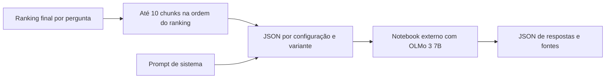

# Geração externa a partir dos rankings

Os runners locais exportam os chunks finais em JSON para permitir gerar respostas
fora da máquina de recuperação. O arquivo é autocontido: inclui perguntas,
texto completo das evidências, fontes e o prompt de sistema compartilhado com
o pipeline de submissão em `src/prompts.py`. Com `include_reference_answers=true`
na configuração, cada pergunta também recebe `expected_answer` com a resposta
original do arquivo de perguntas. Esse campo é salvo para comparação e não entra
nas mensagens enviadas ao modelo.



## Arquivos gerados

Após `tools/run_retrieval.py`, a saída contém `llm_inputs/<variante>.json`.
Após `tools/run_experiments.py`, contém
`llm_inputs/<case_id>/<variante>.json`. O arquivo `llm_inputs/index.json`
lista os caminhos e a quantidade de perguntas de cada exportação.

Cada arquivo representa uma configuração e uma variante, mantendo a ordem
original das perguntas. Cada pergunta tem `id`, `question`, `domain`,
`question_type` e `chunks`. Cada chunk tem `rank`, `chunk_id`, `document_id`,
`document`, `title`, `section`, `text` e `retrieval_score`. O score é o do ranking
daquela variante; não é uma probabilidade de relevância.

`question_ids` na configuração seleciona as perguntas e define sua ordem, sem
alterar `sample_qa.json`. A configuração atual mantém `[7, 1, 5, 13, 23]` e
habilita a exportação das respostas esperadas. O notebook também copia
`expected_answer` para o JSON de respostas, separado da resposta gerada.

São exportados até dez chunks por pergunta. Se `top_k` do runner for menor,
somente os chunks disponíveis serão exportados. A ordem é a do ranking final;
não há nova busca, mudança de pontuação ou truncamento do texto nesta etapa.

Também é possível exportar uma execução já salva, sem recalcular a recuperação:

```bash
.venv/bin/python tools/export_llm_inputs.py --run experiments/runs/SEU_RUN
```

Para incluir as referências ao reexportar, acrescente
`--include-reference-answers`; a execução salva deve conter `answer` em
`questions.jsonl`, como acontece quando essa opção está habilitada no runner.

## Notebook

Abra [olmo3_7b_answers.ipynb](../../notebooks/generation/olmo3_7b_answers.ipynb)
no ambiente externo, copie um dos JSONs e ajuste `INPUT_JSON` no código.
O notebook é composto somente por código e não foi executado no projeto.
Ele instala `transformers`, `accelerate` e `bitsandbytes` no ambiente externo e
carrega `allenai/Olmo-3-7B-Instruct` na GPU 0 com quantização de 4 bits NF4 e
dupla quantização. O cálculo usa BF16 quando a GPU suporta, ou FP16 caso contrário
(incluindo uma T4). A atenção usa SDPA. A configuração segue a
[documentação do Transformers](https://huggingface.co/docs/transformers/quantization/bitsandbytes).

O contexto segue os rótulos de fragmentos/fontes e o empacotamento de `src/main.py`.
As novas exportações incluem `user_message_template`, compartilhado com
`src/prompts.py`, que separa pergunta, referências e tarefa de resposta. O
notebook registra o template no resultado; em JSONs antigos sem esse campo,
preserva a concatenação original de contexto e pergunta.
`MAX_CONTEXT_TOKENS=10_000` limita apenas o contexto de evidências, incluindo seus
rótulos e separadores; pergunta, sistema e template de chat ficam fora desse
orçamento. Os chunks entram em ordem até o próximo exceder o limite. Se o
primeiro não couber, apenas seu texto é truncado, preservando a fonte.
O JSON de entrada mantém todos os dez chunks originais; o JSON de respostas
registra os utilizados, omitidos e truncados em `chunk_ids`, `omitted_chunk_ids`
e `truncated_chunk_ids`. O prompt de sistema vem do JSON e pode ser alterado em
`SYSTEM_PROMPT`. A geração usa `max_new_tokens=2048` e `do_sample=False`, assim
como `main.py`, sem parâmetros de temperatura ou top-p.

Os limites de contexto e saída são editáveis. Quantizar os pesos não elimina a
memória de ativações e do cache de geração; o consumo real deve ser observado
no Colab. Não houve execução do modelo ou medição de VRAM nesta implementação.

O arquivo `<nome>_answers.json` é atualizado após cada resposta e registra
modelo, configuração, variante, prompt, parâmetros, respostas, IDs dos chunks e
contagens de tokens. Executar novamente a célula de geração reinicia as respostas.

O notebook mantém `allenai/Olmo-3-7B-Instruct` quantizado para o Colab.
`main.py` recebe `model_id` da avaliação, sem fixar um identificador, e carrega
esse modelo em BF16. A geração é determinística nos dois casos. Os resultados
permitem comparar experimentos locais, mas não equivalem à acurácia oficial.
O notebook e os JSONs de experimentos ficam fora do ZIP. A exportação usa apenas
a biblioteca padrão e não acrescenta inferência ou modelos ao build.
