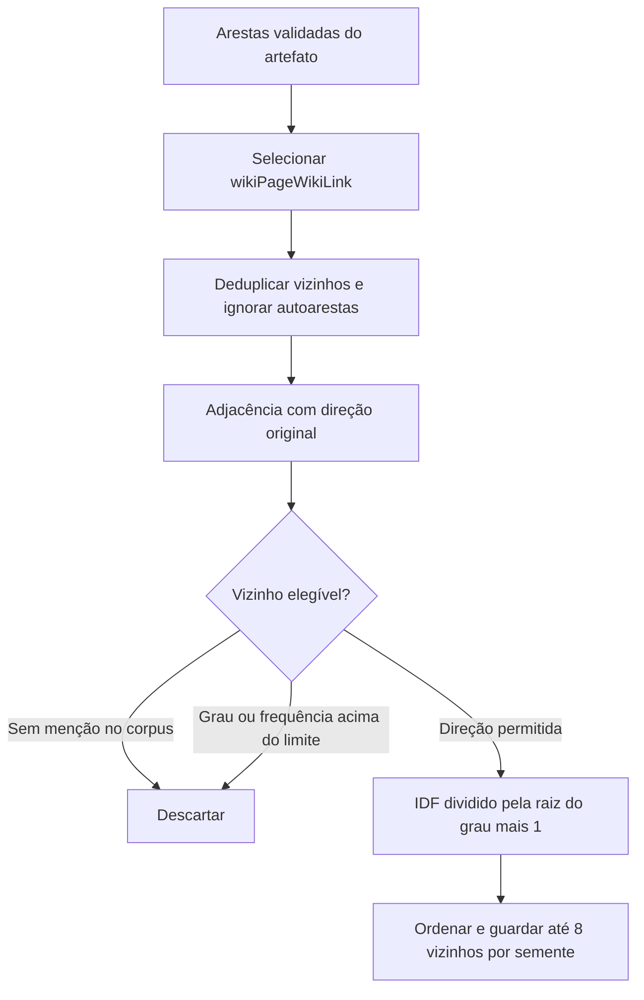
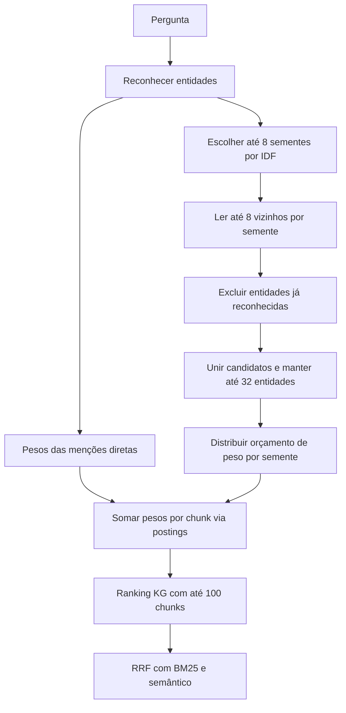

# Exploração do grafo para recuperação

[Visão geral](../technical-overview.md) · [Índice de implementações](README.md)

Implementação: [src/kg_retrieval.py](../../src/kg_retrieval.py), integrada em
[_hybrid_order e _load](../../src/main.py). Este módulo usa somente a biblioteca
padrão do Python; a operação é offline e em CPU.

O padrão atual de submissão é `KG_MODE=off` (híbrido sem KG). Este componente
permanece disponível para ablações explícitas.

## Modos e objetivo

| `KG_MODE` | Canal KG |
| --- | --- |
| `off` | Desativado; apenas BM25 e semântico |
| `mentions` | Chunks que mencionam entidades reconhecidas na pergunta |
| `graph` | Menções diretas + vizinhos de um salto com evidências no corpus; experimental |

Exemplo conceitual: se a pergunta menciona `Alpha` e existe uma associação
`Alpha → Beta`, um chunk sobre `Beta` pode ser recuperado mesmo sem mencionar
`Alpha`. Essa é a contribuição estrutural adicionada ao uso de aliases.

## Identificação de entidades e índice invertido

`EntityMatcher` usa uma trie de tokens Unicode normalizados por NFKC e
`casefold()`. Hífens separam palavras; operadores como `*`, `/` e `+` são mantidos
para não transformar `*-representation` no termo genérico `representation`.

O reconhecimento usa a expressão mais longa. Um label canônico único tem
precedência sobre aliases de outras páginas. Ambiguidades restantes são
ignoradas. Nomes com mais de 12 tokens, palavras unitárias muito curtas e uma
lista pequena de termos comuns são excluídos.

Isso não resolve ambiguidades de sentido: uma palavra pode ter um único destino
no subgrafo e ainda estar sendo usada com outro significado no documento.

`KGChunkIndex` guarda:

- `postings`: URI → IDs dos chunks que mencionam a entidade;
- `chunk_entities`: entidades reconhecidas em cada chunk;
- `degrees`: número de vizinhos distintos de cada nó no grafo;
- `neighbors`: listas limitadas de vizinhos elegíveis para expansão.

Uma entidade é contada uma vez por chunk, independentemente das repetições.

## Preparação das adjacências



As arestas originais permanecem direcionadas. O modo `both` permite explorar
entradas e saídas porque são associações editoriais; o registro do caminho informa
se a ligação original era `semente → vizinho` (`outgoing`) ou `vizinho → semente`
(`incoming`). Uma ligação recíproca tem as duas direções e não duplica seu peso.

Só entram vizinhos que aparecem nos chunks, têm grau até 256 e aparecem em até
50% dos chunks. O grau conta vizinhos distintos em ambas as direções, mesmo ao
usar apenas `incoming` ou `outgoing`. Nós muito conectados são chamados de hubs;
além do corte por grau, os restantes recebem penalização na preferência.

Para `N` chunks e `df(v)` chunks que mencionam `v`:

```text
idf(v) = 1 + ln((N + 1) / (df(v) + 1))
preferência(v) = idf(v) / sqrt(1 + grau(v))
```

As listas são calculadas uma vez por corpus/configuração. O limite por lista é
aplicado antes da pergunta; vizinhos já reconhecidos na pergunta serão removidos
durante a consulta sem preencher novamente essas posições.

## Exploração por pergunta



As menções diretas de **todas** as entidades da pergunta conservam peso `idf`.
O limite de oito sementes vale apenas para expansão. A seleção dessas sementes
prioriza maior IDF, com desempate por URI. Uma semente sem menção direta no corpus
pode expandir para vizinhos que tenham menções.

Cada candidato expandido acumula prioridade:

```text
prioridade(v) = soma, nas sementes s conectadas a v, de idf(s) * preferência(v)
```

Depois do limite global de 32 entidades, cada semente distribui no máximo 25%
do seu IDF entre os vizinhos selecionados:

```text
contribuição(s, v) = 0,25 * idf(s) * preferência(v)
                    / soma das preferências dos vizinhos selecionados de s
peso_expandido(v) = soma das contribuições das sementes conectadas a v
score_KG(chunk) = soma dos IDFs das entidades diretas presentes
                + soma dos pesos das entidades expandidas presentes
```

Assim, muitos vizinhos da mesma semente não multiplicam indefinidamente o peso
da expansão. Um vizinho compartilhado por duas sementes recebe contribuições
das duas, com ambos os caminhos registrados. Não há recursão para vizinhos de
vizinhos, nem busca geral de caminhos de dois saltos.

O fator 0,25 controla a expansão **dentro** do ranking KG. O fator 0,5 do
[RRF](rag-pipeline.md#recuperação-e-fusão) controla o ranking KG na fusão global.
Como o RRF usa posições, a redução de peso interno não se traduz diretamente
em uma redução proporcional no score final do RRF.

## Parâmetros

`GraphConfig` é imutável, validada e parte da chave de cache do índice. As variáveis
abaixo são lidas em `_load()` somente no modo `graph`:

| Campo | Padrão | Variável de ambiente |
| --- | --- | --- |
| `expansion_weight` | 0,25 | `KG_GRAPH_EXPANSION_WEIGHT` |
| `max_seeds` | 8 | `KG_GRAPH_MAX_SEEDS` |
| `max_neighbors` | 8 | `KG_GRAPH_MAX_NEIGHBORS` |
| `max_expanded_entities` | 32 | `KG_GRAPH_MAX_EXPANDED_ENTITIES` |
| `max_neighbor_degree` | 256 | `KG_GRAPH_MAX_NEIGHBOR_DEGREE` |
| `max_neighbor_document_ratio` | 0,5 | `KG_GRAPH_MAX_NEIGHBOR_DOCUMENT_RATIO` |
| `direction` | `both` | `KG_GRAPH_DIRECTION` |

Use ponto decimal no shell. Limites inteiros devem ser não negativos; proporções
devem ser finitas e estar entre 0 e 1. Zero em um dos limites de expansão ou no
peso desativa suas contribuições, mantendo as menções diretas. Valores inválidos
produzem erro explícito.

## Rastreabilidade

`rank(question, top_k)` entrega IDs ao RRF. `retrieve(question, top_k)` entrega
também `matched_entities`, `expansion_seeds`, `expansions` e `hits`.

Cada expansão informa a entidade, o peso, o grau e `via`: sementes, predicado,
direções e contribuição de cada caminho. Cada hit informa score, ID inteiro do
chunk e entidades diretas/expandidas presentes. O chamador pode associar esse
ID ao registro `sources` do pipeline. Os caminhos servem para diagnóstico;
não são afirmações causais nem são adicionados ao prompt como evidências.

## Custo, testes e limites

A preparação percorre as arestas e os chunks uma vez e mantém as listas limitadas
por semente. Com os padrões, uma pergunta examina até 64 entradas de vizinhos e
seleciona no máximo 32 entidades expandidas. O custo de percorrer os postings
ainda depende do tamanho do corpus; esses limites não garantem uma latência
fixa nem os 60 minutos da competição.

[tests/test_graph_retrieval.py](../../tests/test_graph_retrieval.py) verifica
um salto, direções, ciclos/duplicatas, filtros, limites, penalização por grau,
orçamento por semente, vizinhos compartilhados e retorno às menções. A integração
com RRF e contexto está em [test_retrieval.py](../../tests/test_retrieval.py).

O diagnóstico em [kg-graph-report.json](../reports/kg-graph-report.json) usa o
grafo real e **chunks sintéticos de labels**, sem PDFs ou respostas de referência.
Mesmo nesse diagnóstico aparecem associações pouco úteis à pergunta. Grau e IDF
são critérios estruturais; não medem relevância semântica. A melhoria de respostas
precisa ser avaliada com evidências reais antes de considerar esses parâmetros
uma configuração otimizada.
