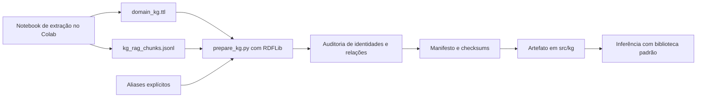

# Preparação e auditoria do KG da DBpedia

[Visão geral](../technical-overview.md) · [Índice de implementações](README.md)

Implementação: [tools/prepare_kg.py](../../tools/prepare_kg.py). A entrada vem do
[notebook de extração](../../notebooks/dbpedia/01_extract_domain_kg.ipynb).
O script converte as exportações já recebidas; não faz uma nova coleta na rede.

## Fluxo offline



Os notebooks estão organizados em [notebooks/dbpedia](../../notebooks/dbpedia/README.md).
O segundo notebook contém protótipos DuckDB/BGE; o pipeline atual usa os arquivos
exportados pelo primeiro. Não é necessário gerar embeddings do KG no Colab.

## Entradas e execução

```text
data/
├── domain_kg.ttl
└── kg_rag_chunks.jsonl
tools/
├── prepare_kg.py
├── kg_aliases.json
└── requirements-kg.txt
```

O JSONL possui um cartão por entidade, com URI, label, aliases, definição,
categorias, propriedades e conceitos relacionados. O Turtle fornece as relações
com URIs e os valores das propriedades. Os conceitos relacionados do JSONL são
listas truncadas de nomes; a adjacência usa os links do Turtle para preservar
identidades e direção.

```bash
.venv/bin/python tools/prepare_kg.py
# Caminhos alternativos:
.venv/bin/python tools/prepare_kg.py --input-dir data --output-dir src/kg
```

RDFLib é necessário somente na preparação e nos testes dessa conversão. A versão
fica em [requirements-kg.txt](../../tools/requirements-kg.txt), separada das
bibliotecas oficiais de avaliação. O módulo de inferência não importa RDFLib,
DuckDB ou SPARQLWrapper. Consulte [ambiente e build](build-and-validation.md).

## Validação e transformação

1. Ler cartões e rejeitar corpus vazio ou URIs duplicadas.
2. Interpretar o Turtle e conferir se cada label dos cartões existe no RDF.
3. Ordenar entidades/aliases e acrescentar apenas os aliases explícitos de
   `tools/kg_aliases.json`, validando seus destinos.
4. Preservar propriedades, datatype e idioma quando presentes no Turtle.
5. Exportar links `wikiPageWikiLink` cujas duas entidades existem nos cartões.
   Links externos ao conjunto são contados no relatório e não entram no artefato.
6. Gerar auditoria, checksums e manifesto; validar novamente a saída com o mesmo
   leitor usado em inferência.

Os arquivos originais não são reescritos. Aliases têm origem registrada em
`alias_sources`, distinguindo redirecionamentos do notebook e adições manuais.
Qualificadores como `(mathematics)` não são removidos automaticamente: transformar
`Building (mathematics)` em `Building` causava uma associação indevida com edifícios.

## Artefato de inferência

```text
src/kg/
├── nodes.jsonl
├── edges.jsonl
├── audit.json
└── manifest.json
```

| Arquivo | Conteúdo |
| --- | --- |
| `nodes.jsonl` | URI, label, aliases/origens, definição, categorias e propriedades |
| `edges.jsonl` | `source`, `predicate` e `target`, preservando o sentido original |
| `audit.json` | Cobertura, contagens, colisões de aliases, graus e limitações dos dados |
| `manifest.json` | Versão, fonte, momento da preparação, hashes das entradas, aliases e arquivos exportados |

O esquema atual tem versão 1. O campo histórico `retrieval: entity-mentions-v1`
identifica esse formato de nós e arestas; os modos `mentions` e `graph` usam o
mesmo artefato. O comportamento é escolhido por `KG_MODE`, sem mudar os dados.

`load_artifact()` verifica a lista de arquivos, o limite total de 100.000.000
bytes, tamanhos, SHA-256, contagens, identidades, labels e endpoints das arestas.
Um arquivo corrompido interrompe a execução; ele não provoca fallback silencioso.
O diretório gerado é ignorado pelo Git. Reexecute a preparação após alterar as
entradas ou os aliases, antes do build.

## Auditoria dos dados recebidos

| Medida | Resultado |
| --- | ---: |
| Entidades | 8.342 |
| Triplas no Turtle | 79.235 |
| Links internos preservados | 60.021 |
| Entidades com definição | 0 |
| Entidades com propriedades | 101 |
| Entidades com aliases exportados | 5.416 |
| Aliases exportados | 22.996 |

A data da extração, a revisão do endpoint e a completude das consultas originais
não estão disponíveis. O manifesto registra essa incerteza e a data da preparação,
sem confundi-las. A origem DBpedia e sua página de atribuição ficam registradas.

O notebook descartou informações de tipos/idiomas antes de serializar alguns
valores; a preparação conserva apenas o que ainda existe no Turtle. Não inventa
unidades ausentes. Há entidades de tópicos pouco pertinentes e aliases ambíguos.
As definições vazias e a cobertura limitada de propriedades motivam usar o grafo
para localizar evidências nos PDFs, em vez de injetar seus valores no prompt.

## Testes

[test_kg.py](../../tests/test_kg.py) cobre corrupção, versão desconhecida,
identidades duplicadas, endpoints ausentes, predicados e conversão de RDF.
O teste de conversão verifica que os arquivos de entrada permanecem iguais e
que datatype presente no Turtle é preservado. Os testes de reconhecimento e
postings estão descritos em [recuperação pelo grafo](graph-retrieval.md).
