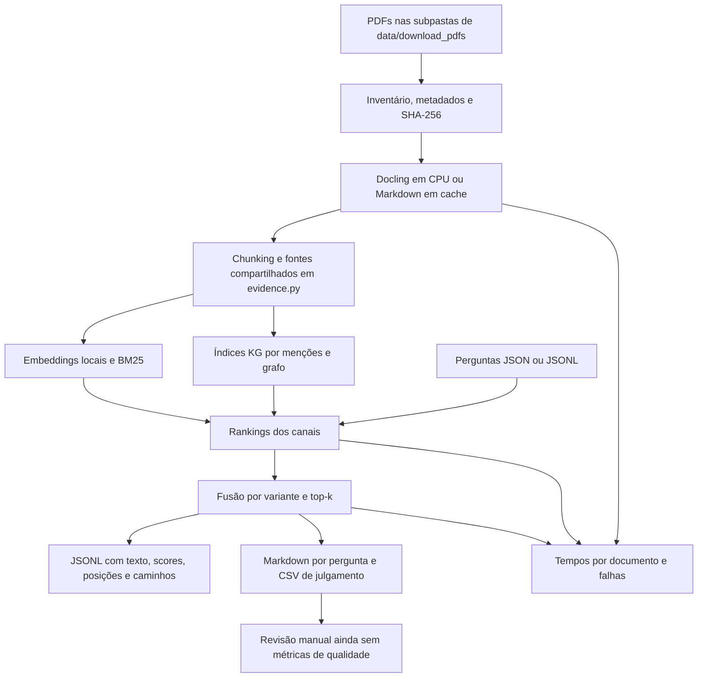

# Recuperação local e revisão manual dos chunks

[Visão geral](../technical-overview.md) · [Índice de implementações](README.md)

Implementação: [tools/run_retrieval.py](../../tools/run_retrieval.py).
O runner processa PDFs reais e exporta candidatos para avaliação humana, sem
carregar OLMo ou seu tokenizer. Não exige rótulos prévios de relevância.

## Fluxo



## Primeira execução

Usar o `.venv` com as dependências oficiais e os modelos locais já preparados:

```bash
.venv/bin/python tools/run_retrieval.py \
  --corpus data/download_pdfs \
  --output experiments/runs/pilot-2026-11-07
```

O runner busca recursivamente os PDFs. O preset `public-25-minilm.json` usa as
25 perguntas e compara cinco variantes sobre o **mesmo corpus completo**;
outras combinações são escolhidas em `variants`:

| Variante | Pesos/canais |
| --- | --- |
| `dense` | Somente semântico, peso 1 |
| `hybrid` | Semântico 1 + BM25 1 |
| `mentions` | Semântico 1 + BM25 1 + KG por menções 0,5 |
| `graph` | Semântico 1 + BM25 1 + KG com expansão 0,5 |
| `bm25` | Opcional: somente BM25, peso 1 |
| `dense_mentions` | Opcional: semântico 1 + menções 0,5, sem BM25 |
| `dense_graph` | Opcional: semântico 1 + grafo 0,5, sem BM25 |

Os modelos são lidos localmente, com modo offline ativado. A extração usa o
mesmo conversor do baseline, com CPU e quatro threads explícitos. Os embeddings
usam `auto` por padrão, em lotes de oito: CUDA quando acessível ao processo,
ou CPU como alternativa. O log e `config.json` registram o dispositivo efetivo. Na RTX 4050, é possível testar
`--embedding-device cuda --batch-size 8`; medir a VRAM antes de aumentar o lote.

O runner não usa o domínio da pergunta para filtrar documentos. Catálogos dos
downloads fornecem título e URL, mas campos como `questions`, `selection_role`
ou `relevance_judgment` não se tornam rótulos nem sinais de recuperação.

Um ensaio menor pode selecionar documentos e perguntas:

```bash
.venv/bin/python tools/run_retrieval.py \
  --document-ids AI-004 DONES-001 --limit-questions 2 \
  --output experiments/runs/smoke-new
```

Cada execução exige um diretório vazio ou novo, para preservar anotações. O
runner não sobrescreve uma execução anterior. Use `status.json` para distinguir
uma execução completa de uma interrompida ou falha.

## Saídas

```text
experiments/runs/<run_id>/
  config.json
  documents.jsonl
  chunks.jsonl
  questions.jsonl
  retrieval.jsonl
  query-timings.jsonl
  timings.json
  summary.json
  status.json
  review.md
  judgments.csv
  answerability.csv
  markdown/
  questions/q-001.md ...
```

| Arquivo | Uso |
| --- | --- |
| `review.md` | Índice para abrir a revisão de cada pergunta |
| `questions/q-NNN.md` | Tabelas por variante, links ao PDF e texto completo dos chunks, reunidos sem repetir o mesmo candidato |
| `judgments.csv` | Uma linha por par pergunta/chunk na união dos top-k; colunas de posição por variante e julgamento vazio |
| `answerability.csv` | Uma linha por pergunta/variante para avaliar a suficiência do conjunto de passagens |
| `retrieval.jsonl` | Hits com texto completo, score de ordenação, cosseno, score BM25, posições por canal e traces KG |
| `chunks.jsonl` | Todos os chunks, fontes relativas, seção, hashes do PDF/texto e auditoria de truncamento pelo encoder |
| `documents.jsonl` | Arquivos encontrados, metadados, páginas, cache, tempos, extrações parciais e falhas |
| `config.json` | Parâmetros, versões, hashes de código/modelos/perguntas e documentos catalogados que não foram encontrados |

Os IDs de chunks usam o caminho relativo do PDF e a posição local, evitando
colisão entre arquivos de mesmo nome em subpastas diferentes. Os IDs inteiros
internos dos traces KG correspondem ao campo `index` de `chunks.jsonl`.

O texto não é cortado para a revisão. `--top-k 10` limita a quantidade exportada
por variante; `--candidate-depth 100` limita os rankings de entrada do RRF.
Scores de fusão e cossenos são sinais de ordenação, não probabilidades de
relevância. **Os candidatos exportados não são o contexto final do OLMo**:
não há aplicação de seu tokenizer nem do orçamento de 10.000 tokens.

## Protocolo de anotação

Preencher `relevance` em `judgments.csv`:

- Vazio: não julgado; não conta como negativo.
- `0`: chunk não responde nem sustenta a pergunta nas condições pedidas.
- `1`: contexto relacionado ou apoio indireto.
- `2`: contém evidência direta útil; pode ser uma das partes necessárias para
  uma pergunta que exige várias evidências.

Registrar `evidence_quote` e `notes` quando útil. Um chunk não relevante não
torna o PDF inteiro um negativo: outra seção pode conter a resposta.

Em `answerability.csv`, preencher `sufficient_evidence` com `yes`, `partial`,
`no` ou `unsure`, olhando o conjunto recuperado pela variante. Isso distingue
encontrar alguma evidência de encontrar tudo que a pergunta exige.
Quando faltar suporte, usar `notes` para distinguir possível documento ausente,
problema de extração e evidência existente que não foi recuperada. A ausência
de um documento no corpus não demonstra, por si só, erro no ranking.

As respostas públicas de referência não são usadas na recuperação nem exibidas
por padrão. `--include-reference-answers` as apresenta no Markdown, caso se deseje
uma revisão guiada. A amostra pública serve para desenvolvimento, pois já foi
usada na preparação de aliases; ela não é teste independente de generalização.

Depois de completar os julgamentos, será possível definir métricas sobre o pool
anotado. A recuperação de candidatos ainda não julgados não deve virar um erro
automático. O runner atual deixa `quality_metrics` como `null`.

## Comparações e parâmetros

Os argumentos podem ser definidos em um JSON e substituídos por flags explícitas.
As grades de pré-processamento e `k1/b` estão descritas em
[configuração de experimentos](experiment-configuration.md). Exemplo de rodada:

```bash
.venv/bin/python tools/run_retrieval.py --config experiments/configs/pipeline.json
```

```bash
# Diagnóstico de BM25 isolado e híbrido:
.venv/bin/python tools/run_retrieval.py --variants dense bm25 hybrid \
  --bm25-weight 0.25 --output experiments/runs/bm25-025

# Isolar KG sem BM25:
.venv/bin/python tools/run_retrieval.py --variants dense mentions graph \
  --bm25-weight 0 --output experiments/runs/kg-without-bm25

# Outros tamanhos de chunk e mais candidatos para leitura:
.venv/bin/python tools/run_retrieval.py --chunk-size 1000 --chunk-overlap 150 \
  --top-k 20 --output experiments/runs/chunk-1000
```

O RRF é compartilhado em [retrieval_utils.py](../../src/retrieval_utils.py).
Os padrões da submissão permanecem os mesmos; o runner oferece pesos
independentes para os experimentos. Os parâmetros de expansão do grafo são os
de [GraphConfig](graph-retrieval.md#parâmetros), via `KG_GRAPH_*`.

Chunking atual é por caracteres e parágrafos, sem limite rígido para um parágrafo
longo. A auditoria registra quantos tokens o encoder receberia sem truncamento
e se excedem seu limite, permitindo inspecionar perda de informação. Esse número
não corresponde à tokenização do OLMo.

## Cache, memória e interpretação dos tempos

O cache fica em `.cache/local-retrieval/`. Markdown é identificado pelo hash do
PDF, versão/configuração do extrator e arquivos dos modelos de layout. Vetores
são identificados pela sequência ordenada de textos e fingerprint do modelo;
o arquivo NumPy é validado por checksum. A execução registra hits/misses.
Extrações parciais e falhas não são guardadas como extrações completas no cache.

`--no-cache` desativa leitura e escrita de cache. Um novo tamanho de chunk pode
reutilizar o Markdown, mas exige vetores novos se os textos forem diferentes.
O processamento é sequencial e libera o conversor antes de carregar o encoder.

Tempos por PDF, carga dos modelos, embeddings, construção dos índices e buscas
são separados. `query-timings.jsonl` registra cada pergunta; `timings.json` inclui
mediana/p95 por etapa, tempo total e pico RSS do processo. VRAM alocada pelo Torch
é registrada quando CUDA está disponível; não é o consumo total da placa.
A inicialização lazy do layout Docling está incluída no tempo da primeira
conversão sem cache; esse custo não é separado como carga de modelo no relatório.

Os canais são calculados uma vez por pergunta e reutilizados pelas variantes.
O tempo total da sessão comparativa não é o tempo isolado de cada variante. Uma
rodada com cache não representa uma avaliação fria, e o runner não inclui geração
OLMo. Não extrapolar essas medições diretamente para a H100 ou para os 60 minutos.

## Testes e empacotamento

[test_local_retrieval.py](../../tests/test_local_retrieval.py) verifica descoberta
recursiva, isolamento de relevância, cache, falhas, textos completos, julgamentos
vazios, pesos e uma execução com encoder/conversor simulados que proíbe carregar
OLMo ou seu tokenizer. Os testes do pipeline de submissão verificam a regressão
da fusão compartilhada.

Resultados, caches e PDFs são ignorados pelo Git. Para preservar julgamentos
manuais em controle de versão, copiar o CSV escolhido para uma pasta de anotações
e manter o vínculo com o run/configuração original. Eles não entram no ZIP.
Os módulos de inferência estão separados por responsabilidade e incluídos no
build; consulte [a organização atual](rag-pipeline.md). A tokenização BM25 de
`lexical.py`, os canais e a seleção são compartilhados por runner e submissão.
