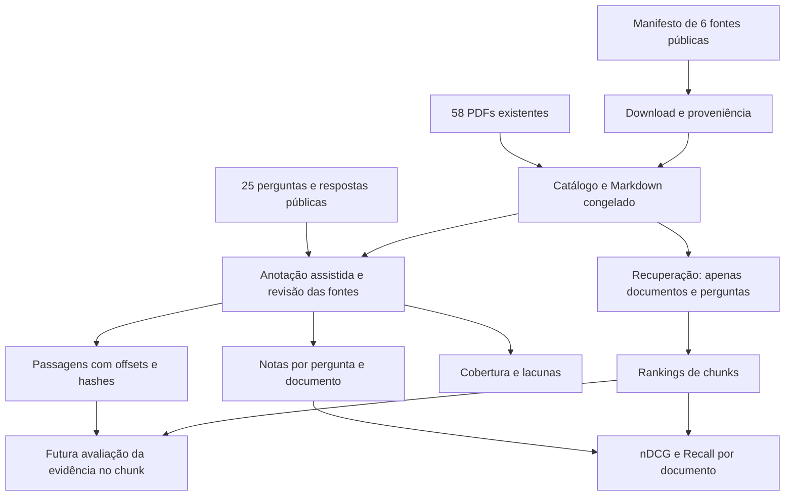

# Conjunto público para avaliação da recuperação

[Índice](README.md) · [Métricas](retrieval-metrics.md) · [Relatório de cobertura](../reports/public-25-corpus-2026-11-08.md)

A base em [`data/local_eval`](../../data/local_eval/README.md) amplia a avaliação
das cinco perguntas anteriores para as **25 perguntas oficiais**. Não cria
perguntas sintéticas nem modifica as respostas de referência. O corpus passa
de 58 para 64 documentos. O objetivo é medir recuperação posteriormente, com
fontes e limitações identificáveis.

## Construção e separação dos dados



[`tools/public_qa_sources.json`](../../tools/public_qa_sources.json) registra as
fontes adicionadas, URLs, licenças informadas e motivo de seleção. As dicas de
perguntas são usadas somente na curadoria. O JSONL de metadados lido pelo runner
contém somente ID, título, domínio e URLs; não inclui respostas nem notas.

[`collect_public_qa_documents.py`](../../tools/collect_public_qa_documents.py)
baixa PDFs públicos, valida o formato e registra tamanho, páginas e SHA-256 em
`download-manifest.json`. Preserva arquivos existentes e registra falhas; encerra
com erro quando algum download falha. Não baixa modelos.

[`prepare_public_eval_corpus.py`](../../tools/prepare_public_eval_corpus.py)
copia os Markdown já usados nas avaliações anteriores, verificando seus hashes,
e converte apenas PDFs novos com Docling em CPU, sem enriquecimento de fórmulas.
Também extrai texto nativo por página com PyMuPDF. Nenhum encoder ou OLMo é
carregado. A reutilização dos textos históricos requer que a pasta da execução
anterior indicada nos julgamentos continue disponível. Uma conversão nova pode
alterar offsets e demanda revisão, em vez de atualizar os hashes silenciosamente.

## Julgamentos e passagens

As notas são **0: não relevante; 1: possivelmente relevante; 2: relevante**.
Nota 2 exige evidência direta de pelo menos um aspecto material da pergunta,
mas não significa cobertura de toda a resposta. Nota 1 inclui contexto útil
e versões conflitantes, com ressalva na justificativa. Nota 0 significa que
nenhum apoio útil foi identificado na triagem, **não** uma negativa exaustiva
confirmada por especialista. Os 1.600 pares têm nota, mas o nível de revisão
está explicitado em `review_status`.

[`annotation-spec.json`](../../data/local_eval/annotation-spec.json) é a fonte
editável da curadoria. Os positivos e as notas são decisões do avaliador; não
são calculados por busca de palavras, pelo ranking atual ou pela resposta da LLM.
As anotações positivas anteriores das seis perguntas já inspecionadas (1, 2,
5, 7, 13 e 23) foram reaproveitadas e receberam fontes adicionais quando cabível.

[`build_public_qa_judgments.py`](../../tools/build_public_qa_judgments.py) resolve
seletores de passagens previamente escolhidas, gera a matriz completa e verifica
compatibilidade com `evaluate_retrieval.load_judgments`. Cada evidência inclui:

- ID estável por pergunta/documento, texto e SHA-256 do trecho;
- caminho e SHA-256 do PDF e do Markdown usados na anotação;
- `start_char` inclusivo e `end_char` exclusivo, contando caracteres Unicode
  no Markdown decodificado em UTF-8, conforme o slicing de strings do Python;
- modalidade `text` ou `figure` e páginas do PDF quando explicitamente anotadas
  (índices a partir de 1; lista vazia significa página ainda não localizada);
- justificativa e, quando anotados, aspectos da resposta que a passagem apoia.

Os seletores podem ser intervalos ou âncoras literais únicas com contexto antes
e depois. Eles apenas localizam a passagem: não atribuem relevância. Os hashes
congelados na especificação impedem aplicar offsets a fontes modificadas.
`evidence.jsonl` contém passagens de notas 1 e 2; filtre a nota antes de usá-las
como referência direta. Uma evidência `figure` usa o trecho textual só como
localizador: a informação substantiva está na imagem, não na legenda.

Essas passagens independem do tamanho do chunk. Ainda **não** há uma métrica
implementada de acerto de passagens: não confundir sobreposição de offsets,
relevância de documento e cobertura dos argumentos necessários na resposta.

## Cobertura e comparações

`coverage.json` e `coverage.csv` registram `supported_text`, `partial_text`,
`requires_figure`, `scope_warning` ou `missing_source`. O primeiro é uma
estimativa de cobertura textual, não uma garantia de resposta correta pelo modelo.
Os grupos de IDs permitem publicar resultados para todas as 25 e para um
subconjunto com apoio textual mais completo, sempre declarando o denominador.

As questões 16, 18 e 21 não têm documento nota 2. O Recall estrito nessas
perguntas será `null` pelo avaliador, pois não há denominador positivo; não é
acerto automático. O nDCG ainda pode ser definido pelos documentos nota 1 e
medirá recuperação de contexto, não da resposta. Não compare médias calculadas
em grupos diferentes como se representassem o mesmo experimento.

## Uso posterior

A configuração [`public-25.json`](../../experiments/configs/public-25.json)
seleciona exatamente os 64 documentos anotados e todas as perguntas, mantendo
stopwords/stemming e preparando comparações `dense`, `bm25` e `hybrid`. O caminho
de embedding acompanha `pipeline.json` no momento da criação; **não** representa
uma recomendação do BGE que obteve 40 na submissão. Revise `embed_model` antes
do próximo experimento. Não houve alteração no modelo ou no ZIP nesta tarefa.

```bash
# Conferir as fontes e os arquivos gerados, sem modelos:
.venv/bin/python tools/build_public_qa_judgments.py --check

# No próximo experimento, após escolher o embedding:
.venv/bin/python tools/run_retrieval.py \
  --config experiments/configs/public-25.json \
  --output experiments/runs/public-25-SEU-EXPERIMENTO

# Para cada variante exportada:
.venv/bin/python tools/evaluate_retrieval.py \
  --input experiments/runs/public-25-SEU-EXPERIMENTO/llm_inputs/hybrid.json \
  --judgments experiments/judgments/public-25-2026-11-08.json \
  --output experiments/runs/public-25-SEU-EXPERIMENTO/metrics-hybrid.json
```

O runner termina nos rankings/exportações, sem executar a LLM. Os testes em
[`test_public_evaluation.py`](../../tests/test_public_evaluation.py) verificam
preservação das perguntas, matriz completa, identidade das evidências e
coerência das lacunas. `--check` também compara os trechos com os Markdown
locais e verifica os PDFs. Essa base é externa ao pacote de submissão; não
acrescenta custo ao limite de uma hora nem ao ZIP de 1 GB.
