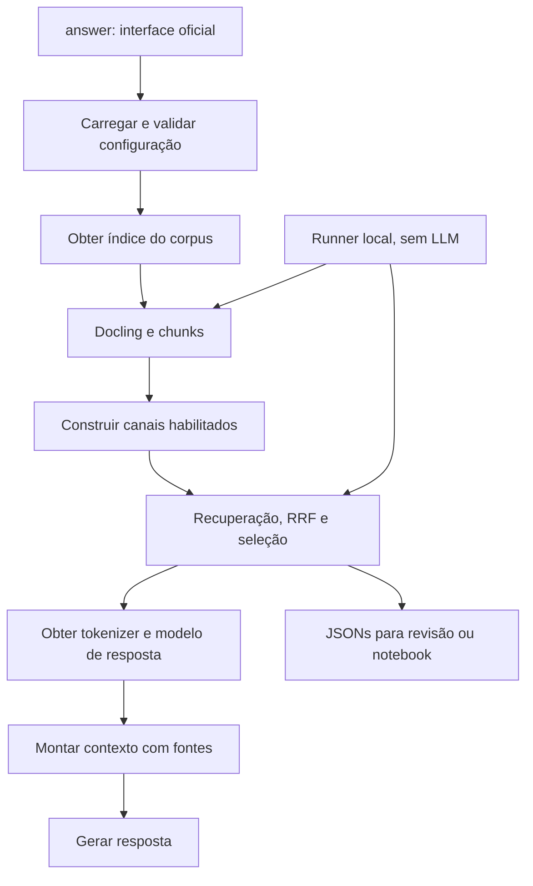

# Pipeline RAG e configuração das técnicas

[Visão geral](../technical-overview.md) · [Como testar](../testing-guide.md)

A interface oficial continua sendo `answer(question, corpus_dir, model_id) -> str`
em [main.py](../../src/main.py). O avaliador fornece o modelo de resposta e uma
pasta com PDFs. O sistema procura evidências sem conhecer o documento correto.

## Organização do código

| Módulo em src | Responsabilidade |
| --- | --- |
| [main.py](../../src/main.py) | Coordenação da entrada oficial e cache de índices |
| [settings.py](../../src/settings.py) | Configuração tipada, valores padrão e validações |
| [pipeline.json](../../src/pipeline.json) | Escolhas da submissão: variante, pesos, dispositivos e limites |
| [documents.py](../../src/documents.py) | Construção do conversor Docling offline |
| [evidence.py](../../src/evidence.py) | Chunking por seção, metadados, penalizações e vizinhança |
| [indexing.py](../../src/indexing.py) | Índice do corpus e construção apenas dos canais habilitados |
| [embedding.py](../../src/embedding.py) | Instruções de consulta/documento e codificação |
| [lexical.py](../../src/lexical.py) | Tokenização, stopwords, stemming e construção BM25 |
| [kg_retrieval.py](../../src/kg_retrieval.py) | Artefato, entidades, postings e exploração do grafo |
| [retrieval_utils.py](../../src/retrieval_utils.py) | Definição das variantes e RRF ponderado |
| [retrieval.py](../../src/retrieval.py) | Rankings estáveis dos canais e seleção final compartilhada |
| [context.py](../../src/context.py) | Empacotamento com fontes e orçamento de tokens |
| [generation.py](../../src/generation.py) | Carregamento tardio da LLM e geração determinística |
| [prompts.py](../../src/prompts.py) | Instruções de sistema e mensagem com pergunta/evidências |
| [runtime.py](../../src/runtime.py) | Escolha explícita de CPU/CUDA e diagnóstico |

O runner local mantém sua descoberta recursiva, caches em disco, auditorias e
exportações. Ele usa as mesmas definições de canais, rankings, chunking e
seleção da submissão; não importa o ponto de entrada para acessar funções
privadas e não chama `generation.load_model`.

## Configuração da submissão

`src/pipeline.json` é um JSON plano, validado por `PipelineConfig`. Caminhos
relativos são resolvidos ao lado desse arquivo, portanto `embed_model` aponta
para o encoder empacotado. `RAG_CONFIG` pode selecionar outro arquivo em uma
execução local da interface oficial. `KG_MODE` continua como alternativa legada
para ativar `mentions`, `graph` ou desligar o canal KG.

| Campo | Função |
| --- | --- |
| `variant` | `dense`, `bm25`, `hybrid`, `mentions`, `graph`, `dense_mentions`, `dense_graph` |
| `dense_weight`, `bm25_weight`, `kg_weight` | Pesos dos canais no RRF; zero desativa o canal |
| `rrf_k`, `candidate_depth`, `top_k` | Suavização do RRF, profundidade por canal e contexto final |
| `bm25_stopwords`, `bm25_stemming` | Pré-processamento lexical |
| `bm25_k1`, `bm25_b`, `bm25_epsilon` | Parâmetros BM25 |
| `formula_enrichment` | Reconhecimento opcional de fórmulas; exige pesos locais |
| `penalize_metadata` | Penalizar capas e referências |
| `continuity` | Expandir vizinhos da mesma seção |
| `reference_weight`, `front_matter_weight` | Fatores de penalização |
| `neighbors_before`, `neighbors_after`, `small_section_chunks` | Limites da continuidade |
| `embedding_device`, `docling_device`, `query_device`, `llm_device` | Dispositivos de cada etapa |
| `chunk_size`, `chunk_overlap` | Tamanho nominal em caracteres e sobreposição |
| `max_context_tokens`, `max_new_tokens` | Orçamento de evidências e limite da resposta |

Os defaults preservam híbrido 1/1, RRF 60, top 10, stopwords/stemming e
penalizações. Continuidade e fórmulas permanecem desligadas. Alterar uma técnica
não requer editar `answer()`. Não existem etapas vazias de reranking ou outros
componentes futuros: quando forem implementados, entram no módulo responsável.

## Recuperação e fusão

`variant_weights` é a definição única dos canais. `rank_candidates` usa os
canais habilitados para produzir candidatos. Rankings semânticos usam produto
escalar de vetores normalizados; BM25 descarta scores zero. `rrf_fuse` combina
posições por `sum(peso / (k + posição))`, com desempate determinístico por índice.
`select_evidence` aplica penalizações e, se habilitada, continuidade.

Os experimentos usam essas mesmas operações e registram scores/ranks dos canais
para diagnóstico. A construção de BM25 é omitida em um teste só semântico;
um teste só BM25 não carrega encoder nem calcula vetores. Os canais KG só
constroem índices quando participam com peso positivo. Solicitar KG com artefato
inexistente/corrompido produz erro, evitando mudar a experiência silenciosamente.

## Cache e dispositivos

`main._indices` usa caminho absoluto do corpus, a configuração imutável completa
e a configuração do grafo como chave. `generation._models` usa modelo/dispositivo,
independentemente dos índices. Novas configurações no mesmo processo podem
manter vários índices em RAM; use processos separados para medir memória.

Na submissão, documentos são codificados no dispositivo de embedding escolhido,
e o encoder retorna à CPU por padrão antes do carregamento da LLM. O modelo de
resposta usa CUDA por padrão. Essa separação reduz a competição por VRAM.
No runner sem LLM, o encoder pode permanecer na GPU para as consultas.

`auto` escolhe CUDA quando acessível, caso contrário CPU. `cuda` exige GPU e
falha explicitamente se indisponível. `cpu` fixa CPU. O produto com os vetores
NumPy e as buscas lexical/KG continuam em CPU. `config.json` registra o pedido,
o dispositivo efetivo e os canais executados; `timings.json` registra cache.

## Contexto e geração

`context.build_context` preserva fonte e seção dos fragmentos e limita o bloco
completo de evidências a 10.000 tokens por padrão. Se o primeiro chunk exceder
o orçamento, corta apenas seu texto; as fontes permanecem. Se nem os rótulos
couberem, retorna contexto vazio. O orçamento não inclui as instruções/pergunta.

A LLM é carregada somente em `generation.load_model`, usando arquivos locais.
O prompt separa pergunta e referências. A geração mantém `do_sample=False`,
2.048 novos tokens e decodifica somente o trecho posterior à entrada. Esses
padrões também orientam o notebook externo. Não há execução da LLM durante
os testes locais de recuperação.

## Verificação

A refatoração é validada por testes dos módulos, da API oficial, do cache,
da desativação real dos canais e da importação do pacote plano do build.
Uma reprodução do código anterior e do novo compara rankings e exportações
sobre o mesmo corpus em CPU. Consulte o relatório de refatoração para o
resultado dessa verificação e o [guia de testes](../testing-guide.md) para uso.
