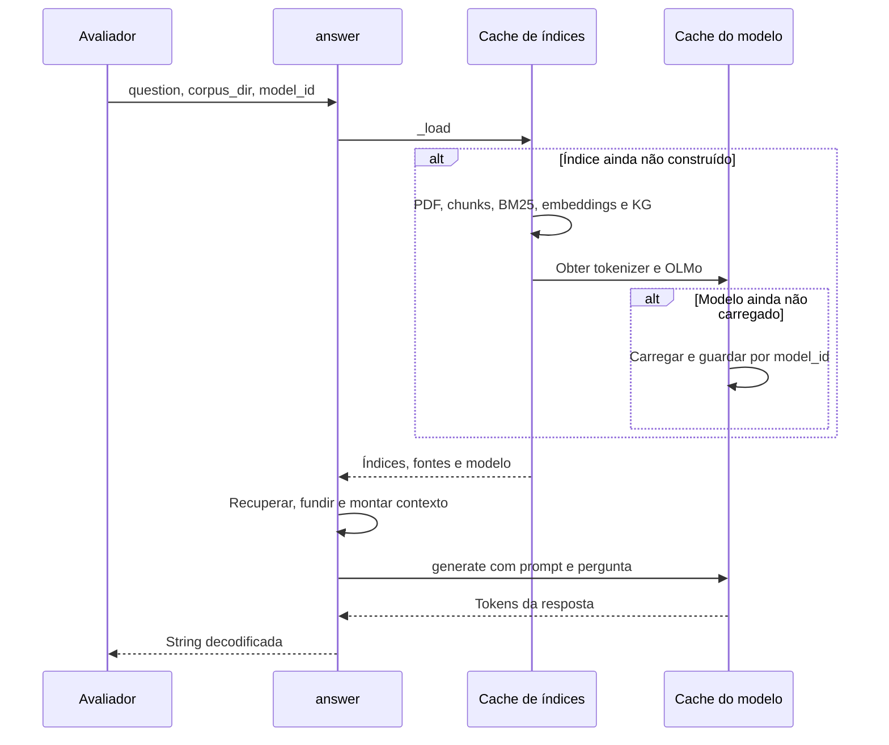
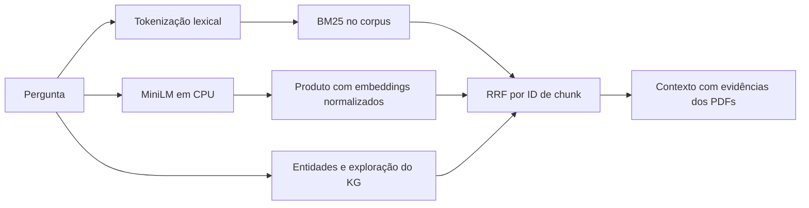

# Pipeline RAG e recuperação híbrida

[Visão geral](../technical-overview.md) · [Índice de implementações](README.md)

Implementação: [src/main.py](../../src/main.py).

## Contrato e inicialização

A função pública `answer(question, corpus_dir, model_id)` retorna uma string.
O corpus é acessado como no baseline oficial: PDFs diretamente em `corpus_dir`,
ordenados pelo nome. O sistema não recebe o documento correto da pergunta.



`_cache` usa modelo, caminho absoluto do corpus, modo KG e configuração do
grafo como chave. Isso evita reutilizar um índice com configuração diferente.
`_model_cache` mantém uma única instância do modelo/tokenizer por `model_id`,
inclusive quando se troca a configuração de recuperação no mesmo processo.
Os índices de configurações anteriores permanecem na memória; para medir RAM
entre variantes, use processos separados.

## PDF, chunking e fontes

- Docling converte PDFs para Markdown com layout Transformers e CodeFormulaV2
  locais. Fórmulas detectadas são reconhecidas em LaTeX.
- OCR e reconhecimento de estrutura de tabelas estão desativados, conforme o
  baseline. Isso limita a qualidade de extração de tabelas e documentos escaneados.
- Um PDF que falha é registrado e ignorado; os demais continuam sendo processados.
- `_chunk_markdown()` agrupa parágrafos mirando 800 **caracteres**, com uma
  cauda de até 150 caracteres de sobreposição apenas dentro da seção. Blocos
  de fórmulas não são divididos ou usados como caudas cortadas. Um parágrafo longo pode superar 800;
  esse valor não é um limite rígido nem uma quantidade de tokens.

Cada chunk tem uma posição inteira compartilhada por todos os rankings. Em
paralelo, `sources` guarda `chunk_id` (`nome.pdf#posição_local`), `document` e
`section`, `section_id`, `section_path`, `local_chunk_index` e `content_kind`.
Títulos Markdown iniciam novos chunks. A seção é uma referência textual, não
um mapa exato de páginas.
O texto original do chunk permanece disponível.

## Recuperação e fusão



O BM25 usa `rank-bm25` do ambiente oficial, com a mesma tokenização Unicode em
documentos e perguntas: `casefold()`, `\w+`, remoção de stopwords em inglês e
Porter stemming. A submissão usa `k1=1.2`, `b=0.75`, `epsilon=0.25`. Chunks com score lexical zero são
excluídos do ranking lexical. O índice é construído uma vez; corpus sem tokens
não cria BM25.

A busca densa usa a cópia local de `all-MiniLM-L6-v2` em CPU. Os embeddings dos
chunks são float32, normalizados, gerados em lotes de 64. A pergunta é codificada
uma vez por busca; produto escalar entre vetores normalizados produz a ordenação
semântica. Os notebooks experimentais usam outro modelo, mas esse não é carregado
pelo pipeline de submissão.

O terceiro canal é descrito em [recuperação pelo grafo](graph-retrieval.md).
Cada canal entrega até 100 IDs de chunks. Para o chunk `c`:

```text
RRF(c) = 1 / (60 + posição_BM25(c))
       + 1 / (60 + posição_densa(c))
       + 0,5 / (60 + posição_KG(c))
```

O cálculo está compartilhado com o runner local em
[retrieval_utils.py](../../src/retrieval_utils.py). As posições começam em 1.
Um canal ausente ou que não recuperou o chunk não
contribui. O RRF funde posições, não compara diretamente scores BM25, cossenos e
scores do grafo. Empates finais são resolvidos pela posição inteira do chunk.
A união tem no máximo 300 candidatos. Peso KG 0,5 e `k=60` são parâmetros atuais,
sem garantia de otimalidade.

Após o RRF, capas e bibliografias recebem uma redução multiplicativa de score.
A seleção expande seções curtas ou uma janela local na mesma seção e documento,
até dez chunks, sem duplicar IDs. A ordem dentro de cada bloco é a da fonte.
Detalhes e parâmetros em [Evidências e fórmulas](evidence-and-formulas.md).
O padrão é semântico + BM25; o termo KG da fórmula acima só existe quando
`KG_MODE=mentions` ou `graph` é explicitamente habilitado.

## Contexto e geração

O contexto inclui títulos, fontes, seções e separadores dentro de um orçamento
de 10.000 tokens, contado com o tokenizer do OLMo. Os blocos seguem as âncoras após penalização e a continuidade por seção.
Quando o próximo não cabe, o preenchimento para; não é um algoritmo de mochila.
Se o primeiro chunk for longo demais, seu texto é truncado por busca binária de
prefixo, preservando os rótulos de fonte. Sem espaço para uma evidência, o contexto
é vazio. O limite é do bloco de contexto, não do prompt completo com a pergunta
e o template de chat.

O OLMo fornecido é carregado com `bfloat16` e `device_map="cuda"`. A geração usa
`do_sample=False`, até 2.048 tokens novos e `torch.no_grad()`. O tokenizer aplica
o template de chat; apenas os tokens novos são decodificados como resposta.

O KG altera a seleção dos chunks, mas suas propriedades e caminhos não são
injetados como fatos no prompt. As fontes do contexto são os PDFs.

O prompt em `src/prompts.py` pede resposta direta e breve com referências
`[Fragment N]` que sustentem as afirmações. Ele orienta a correção de premissas
contraditas, a preservação de unidades e quantificadores e a identificação de
lacunas, sem inventar fórmulas ou comparações. `build_user_message()` separa
pergunta, evidências e tarefa de resposta; o bloco de contexto conserva seu
orçamento e empacotamento. As instruções adicionais ficam fora dos 10.000 tokens
das evidências. Não há nova chamada a modelos nem dependência adicional; o
efeito em qualidade e tempo ainda depende de avaliação. O texto completo da
revisão e o teste controlado estão no
[relatório de evidência manual](../reports/manual-evidence-q13-q23-2026-11-07.md#revisão-do-prompt-após-este-diagnóstico).

## Validação e limites

[tests/test_retrieval.py](../../tests/test_retrieval.py) cobre alinhamento entre
índices e fontes, corpus vazio, PDFs inválidos, fusão ponderada, recuperação de
um candidato apenas pelo grafo, montagem do contexto e reutilização de modelos.
Os modelos e PDFs são simulados nesses testes. O tempo completo, a memória da
H100 e a qualidade das respostas precisam de avaliação end-to-end no corpus.
