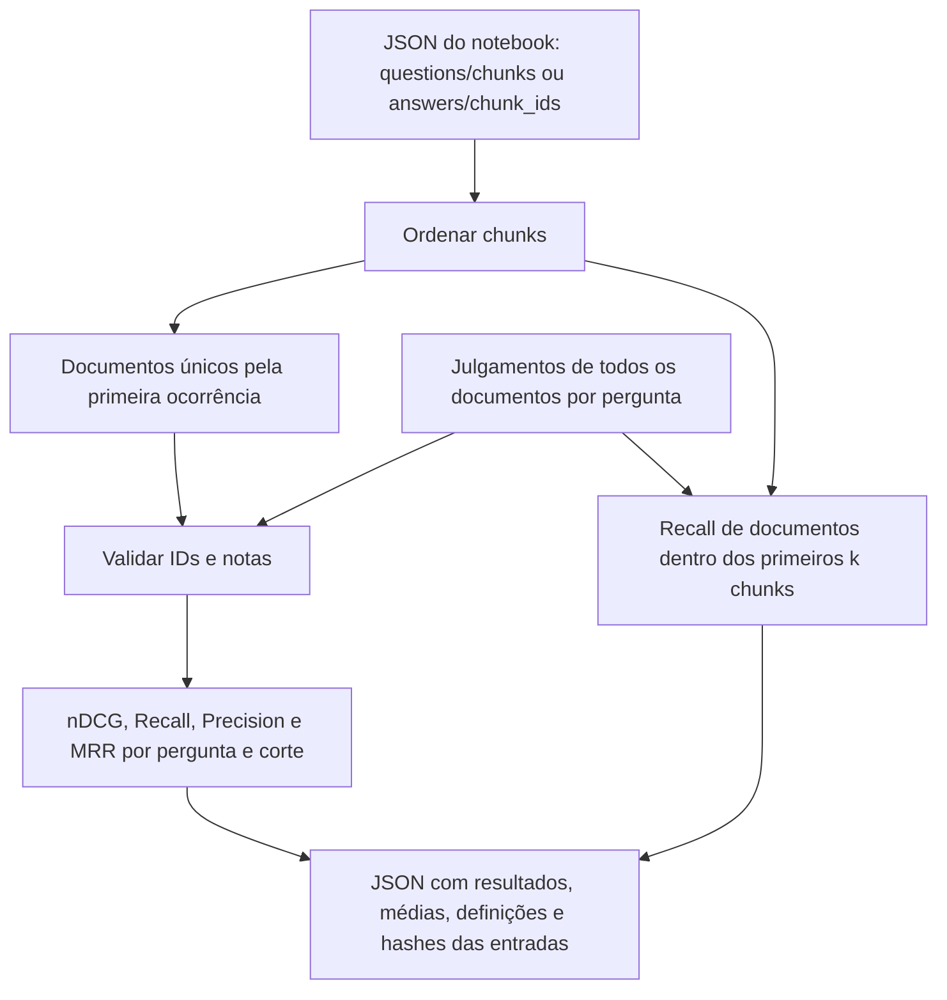

# Avaliação da recuperação por documentos

[Índice de implementações](README.md) · [Experimentos](../../experiments/README.md)

O script [`tools/evaluate_retrieval.py`](../../tools/evaluate_retrieval.py) compara
o JSON enviado ao notebook, ou o JSON de respostas devolvido por ele, com um
arquivo de julgamentos de relevância. Usa somente a biblioteca padrão do Python,
sem carregar modelos. Ele avalia recuperação de documentos; não atribui uma nota
à resposta da LLM nem demonstra que um chunk específico contém a evidência certa.

A [base ampliada das 25 perguntas](public-evaluation-dataset.md) está em
[`public-25-2026-11-08.json`](../../experiments/judgments/public-25-2026-11-08.json).
Ela inclui 64 documentos, passagens de apoio independentes do chunking e
classificação de lacunas. As notas 0 são negativas provisórias de triagem.

## Notas e arquivos de julgamento

| Nota | Rótulo | Critério |
| --- | --- | --- |
| 0 | Não relevante | Sem evidência identificada que ajude na pergunta específica |
| 1 | Possivelmente relevante | Contexto próximo ou contribuição indireta, com utilidade incerta |
| 2 | Relevante | Evidência direta sobre pelo menos um aspecto necessário da resposta |

Uma nota 2 não significa que o artigo sozinho responda a toda a pergunta. Os
julgamentos iniciais são **estimativas do assistente**, apoiadas na pergunta,
resposta pública de referência, títulos e texto dos documentos locais. Precisam
ser revisados pelo pesquisador e podem mudar. O uso da resposta de referência é
restrito à avaliação: os julgamentos não participam da busca.

O formato é:

```json
{
  "schema_version": 1,
  "unit": "document",
  "status": "assistant_estimate",
  "coverage": "all_local_documents",
  "corpus_documents": [{"document_id": "AI-007", "title": "..."}],
  "questions": [{
    "id": "13",
    "judgments": [{
      "document_id": "AI-007",
      "grade": 2,
      "label": "relevante",
      "rationale": "Contém o teorema e a construção de Y.",
      "evidence": []
    }]
  }]
}
```

Com `coverage=all_local_documents`, cada pergunta deve ter uma nota para cada
documento listado em `corpus_documents`. Isso inclui documentos fora do ranking,
necessários para calcular o denominador do Recall e o ranking ideal do nDCG.
Ausência de anotação não equivale a nota 0. Por padrão, documentos recuperados
sem julgamento causam erro; `--unjudged zero` permite uma convenção explícita
para avaliações parciais, registrando os IDs sem anotação no resultado.

## Executar

```bash
.venv/bin/python tools/evaluate_retrieval.py \
  --input experiments/runs/covered-five-2026-11-08/run/llm_inputs/hybrid.json \
  --judgments experiments/judgments/selected-five-2026-11-08.json \
  --k 1 3 5 10 \
  --output experiments/runs/covered-five-2026-11-08/metrics.json
```

`--input` também aceita o `*_answers.json` do notebook. Nesse caso, usa somente
`chunk_ids`, os trechos efetivamente selecionados para o contexto. Os IDs em
`omitted_chunk_ids` não entram. As respostas geradas e esperadas não entram nas
fórmulas das métricas. Trechos truncados ainda identificam seu documento, mas essa
avaliação não mede a perda de conteúdo causada pelo truncamento.

## Como o ranking é interpretado



No ranking principal, cada artigo conta uma vez, na posição da primeira
ocorrência entre os chunks. `at_document_k` usa cortes em **documentos únicos**.
Por exemplo, chunks de A, A, B viram documentos A, B. O corte `k=2` considera
ambos. Se o top 10 de chunks trouxer apenas dois artigos, o avaliador conhece
somente esses dois documentos; não reconstrói os candidatos que ficaram de fora.

Também há `at_chunk_k_document_coverage`: o Recall de documentos cobertos pelos
primeiros k **chunks**, com repetições contadas uma vez. No exemplo A, A, B, o
corte de dois chunks cobre somente A. Esse campo ajuda a observar o custo da
continuidade por seção no orçamento de contexto.

## Métricas

- **nDCG@k:** ganho `2^nota - 1` (0, 1 ou 3), com desconto
  `log2(posição + 1)`. Divide o DCG recuperado pelo DCG ideal, construído com
  **todos** os documentos anotados para aquela pergunta, ordenados por nota.
- **Recall@k:** documentos relevantes recuperados até k, divididos por todos os
  documentos relevantes anotados para a pergunta. `recall_ge1` inclui notas 1 e
  2; `recall_ge2` inclui somente nota 2.
- **Precision@k:** quantidade de relevantes recuperados dividida por k,
  inclusive quando o ranking retorna menos que k documentos. Também há os dois
  limiares de relevância.
- **MRR@k:** inverso da posição do primeiro documento relevante dentro do corte;
  zero quando ele não aparece, com os mesmos dois limiares.

Quando não existe documento relevante anotado para um limiar, seu Recall e MRR
são `null`; nDCG também é `null` quando o ganho ideal é zero. A média macro usa
somente as perguntas com denominador definido e informa quantas entraram.
Uma pergunta com documentos relevantes, mas nenhum recuperado, recebe zero.

## Limitações e verificação

Um ranking pode obter boas notas por encontrar o artigo certo e ainda enviar
capas, referências ou uma seção sem a prova necessária. Para medir esse problema,
é preciso anotar a relevância dos **chunks** separadamente. O Recall calculado
aqui cobre apenas o corpus local anotado, não todo o conhecimento disponível
nem o corpus oculto da competição. Comparar execuções exige o mesmo corpus e a
mesma versão dos julgamentos; hashes das entradas ficam no resultado.

Os testes em [`tests/test_retrieval_metrics.py`](../../tests/test_retrieval_metrics.py)
conferem cálculos conhecidos, deduplicação de artigos, cobertura por chunks,
denominadores, entradas do notebook e erros de anotação. A ferramenta não altera
o pipeline de submissão nem seu consumo de GPU ou o tamanho do ZIP.
