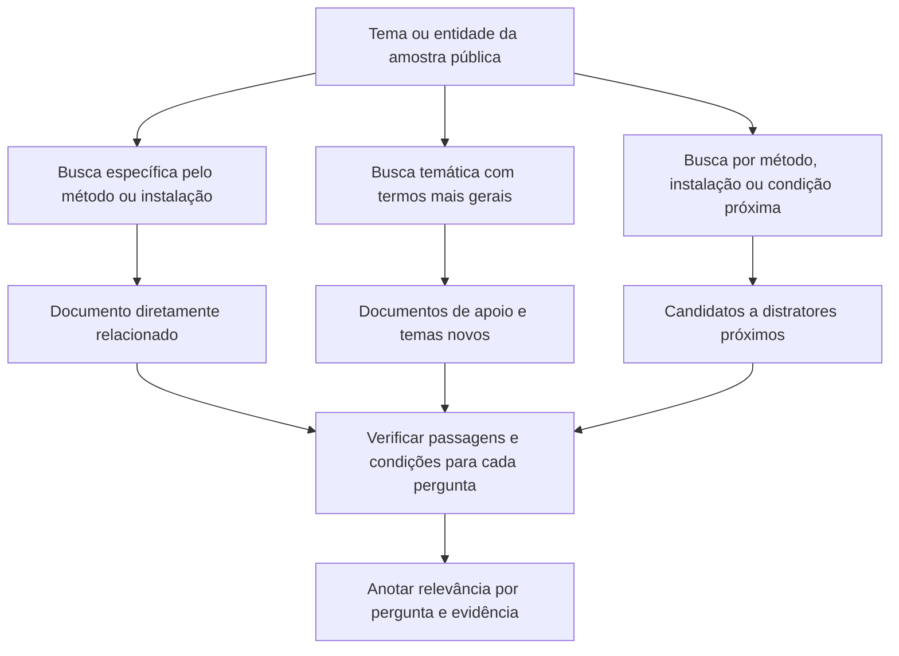

# Buscas para construir o corpus local

As expressões abaixo foram organizadas a partir das 25 perguntas de
[sample_qa.json](../../starter-kit/IEEE-CIS-DSQA-Starter-Kit/sample/sample_qa.json).
São sementes de coleta, não uma lista de documentos obrigatórios ou rótulos
automáticos de relevância. Complementam o
[plano de experimentos](experimentation-roadmap.md).

## Estratégia



Uma palavra compartilhada não torna um documento relevante. Da mesma forma,
um método ou instalação diferente não torna automaticamente um documento um
negativo. A classificação depende da pergunta e da existência de suporte no texto.

## IFMIF-DONES

Cada expressão entre crases é uma busca separada. Começar em JACoW/AccelConf e
Eurofusion, presentes no [sites.txt](../../starter-kit/IEEE-CIS-DSQA-Starter-Kit/sample/sites.txt).

| Perguntas | Tema | Buscas específicas | Buscas próximas para ampliar/contrastar |
| --- | --- | --- | --- |
| 1–2 | Diagnóstico de feixe | `IFMIF DONES beam diagnostics`; `"optical transition radiation" scintillation`; `"interceptive beam diagnostics"` | `"non-interceptive beam diagnostics"`; `"electron beam" scintillator diagnostics`; `"beam position monitor"` |
| 3–5 | Ativação e inventário radiológico | `"DONES" "beryllium-7"`; `"DONES" "lithium loop" activation`; `"DONES" tritium inventory` | `"ITER" tritium inventory`; `"DEMO" activation inventory`; `"lithium" corrosion activation` |
| 3–5 | Códigos e modelos de ativação | `"DONES" "FISPACT-II"`; `"DONES" "MCNP"`; `"lithium" "McDeLicious"` | `"FISPACT-II" activation steel`; `"MCNP" neutron shielding`; `"TENDL" deuteron activation` |
| 6 | Remoção de calor e vazão | `"DONES" "heat exchanger"`; `"DONES" "heat removal system"`; `"liquid lithium" "mass flow rate"` | `"liquid sodium" "heat exchanger"`; `"lithium" "thermal hydraulic" loop` |
| 7–8 | Controle de impurezas e armadilhas | `"DONES" "impurity control system"`; `"DONES" "nitrogen trap"`; `"DONES" "cold trap"`; `"DONES" "bypass"` | `"IFMIF" "nitrogen trap"`; `"LIFUS" lithium purification`; `"lithium" "hydrogen trap"` |
| 9 | Instalação e construção civil | `"IFMIF DONES" "main building"`; `"IFMIF" "engineering design"`; `"DONES" "facility layout"` | `"IFMIF EVEDA" "facility layout"`; `"ITER" "building dimensions"` |
| 10 | Manutenção e radioproteção | `"DONES" "remote handling"`; `"DONES" "hands-on maintenance"`; `"DONES" "residual dose rate"` | `"ITER" "remote maintenance"`; `"accelerator" "shutdown dose rate"` |

Variar nomes equivalentes: `IFMIF-DONES`, `IFMIF DONES`, `DONES`; `Be7`, `Be-7`,
`7Be`, `beryllium-7`; `tritium`, `3H`; `lithium loop`, `Li loop`; `OTR`,
`optical transition radiation`. Não buscar apenas as abreviações isoladas.

Na pergunta sobre nitrogênio, não pressupor que a armadilha seja online: procurar
o sistema e verificar a condição no documento. Nas comparações entre instalações,
registrar ano, versão do projeto e condições; valores não são intercambiáveis.

## IA e matemática especializada

Priorizar arXiv, OpenReview, ACL Anthology, NeurIPS e JMLR. Para a questão de
espaços de Banach, incluir IMPAN e EMS Press, também presentes na lista oficial.

| Perguntas | Método/tema | Buscas específicas | Buscas próximas para ampliar/contrastar |
| --- | --- | --- | --- |
| 11 | OneSearch e tokenização discreta | `"OneSearch" "RQ-Kmeans"`; `"OneSearch" "RQ-VAE"`; `"residual quantization" "generative retrieval"` | `"residual vector quantization" tokenizer`; `"semantic identifiers" retrieval`; `"balanced k-means"` |
| 12 | Explicações contrafactuais | `"ONB-MACF"`; `"counterfactual explanations" "immutable features"`; `"counterfactual" projections morphology` | `"DiCE" counterfactual`; `"FACE" counterfactual`; `"actionable recourse"` |
| 13 | Espaços de Banach | `"Properties of lush spaces"`; `"lush spaces" "numerical index 1"`; `"lushness" "separably determined"` | `"Banach spaces" "Daugavet property"`; `"Lipschitz numerical index"`; `"lush spaces" ultraproducts` |
| 14 | Avaliação de explicações | `"REVEL" explainability`; `"REVEL" "local concordance"`; `"explanation evaluation" "bounded metrics"` | `"LEAF" explanation evaluation`; `"local fidelity" explanation metrics`; `"explanation stability"` |
| 15, 19 | WinStat e séries temporais | `"WinStat" "time series"`; `"WinStatFlex"`; `"window statistics" "positional encoding"` | `"time series" "sliding window" transformer`; `"time series" "learnable positional encoding"` |
| 16–17 | Mapas cognitivos fuzzy | `"fuzzy cognitive maps" "relative activation"`; `"Dynamic Behavior of Fuzzy Cognitive Maps"`; `"fuzzy cognitive maps" "state space shrinking"` | `"fuzzy cognitive maps" convergence`; `"fuzzy cognitive maps" learning weights`; `"fuzzy cognitive maps" fixed point` |
| 18 | Viés em geração de imagens | `"Fairness by Brute Force"`; `"text-to-image" "dissatisfaction"`; `"text-to-image" "occupational bias"` | `"gender bias" "image generation"`; `"demographic bias" "text classification"` |
| 20 | ZeroDiff | `"ZeroDiff" "zero-shot learning"`; `"ZeroDiff" "representation generator"`; `"visual-semantic correlation" diffusion` | `"zero-shot learning" "feature generation"`; `"generalized zero-shot learning" diffusion` |
| 21 | ThinkMore e comparação de modelos | `"ThinkMore" chess`; `"hierarchical neuro-symbolic search" chess`; `"transformer re-evaluation" chess` | `"chess" "Bayesian comparison"`; `"region of practical equivalence" "Bernoulli"`; `"neural chess" "tree search"` |
| 22 | SimCLR | `"SimCLR" "data augmentation"`; `"contrastive learning" "composition of augmentations"` | `"supervised contrastive learning"`; `"self-supervised learning" "augmentation strategies"` |
| 23 | Robustez bizantina | `"Byzantine resilience" "Krum"`; `"alpha f" "Byzantine"`; `"federated learning" "Bulyan"` | `"FLTrust"`; `"SignGuard"`; `"federated learning" "trimmed mean"`; `"geometric median" aggregation` |
| 24 | GPAIS e mundo aberto | `"General Purpose Artificial Intelligence Systems" "Definition and Taxonomy"`; `"GPAIS" "active learning"` | `"open-world learning" "active learning"`; `"general purpose AI" taxonomy`; `"continual learning" supervision` |
| 25 | Mamba e modelos de espaço de estados | `"Mamba" "selective copying"`; `"selective state spaces"`; `"linear time invariant" "sequence modeling"` | `"S4" "state space model"`; `"structured state spaces" "long sequences"`; `"Mamba-2"` |

As expressões específicas encontram o trabalho citado ou muito próximo dele.
As temáticas ampliam a coleção além dos nomes próprios. As de contraste são
candidatos a documentos de apoio ou negativos difíceis, dependendo da pergunta.

## Consultas por site

```text
site:proceedings.jacow.org "DONES" "beam diagnostics" filetype:pdf
site:accelconf.web.cern.ch "DONES" "lithium" filetype:pdf
site:scipub.euro-fusion.org "DONES" "impurity control"
site:arxiv.org "Mamba" "selective copying"
site:openreview.net "zero-shot learning" diffusion
site:proceedings.neurips.cc "Byzantine" "Krum"
site:impan.pl "lush spaces" "numerical index"
```

Se a consulta exata não retornar resultados, remover gradualmente aspas ou
restrições e buscar o título/método sozinho. `filetype:pdf` pode excluir páginas
de resumo úteis; usá-lo como refinamento, não em todas as consultas.

## Montagem dos negativos difíceis

Para cada pergunta, classificar candidatos após leitura:

- **Suporte direto:** contém a evidência necessária, nas condições pedidas.
- **Apoio parcial:** explica conceitos, mas não resolve a pergunta completa.
- **Negativo difícil:** compartilha termos e assunto, mas não fornece a evidência.
- **Não julgado:** ainda não foi inspecionado; não tratar como negativo conhecido.

Exemplos: manutenção em ITER pode ser um negativo difícil para um limite de dose
específico de DONES; um artigo sobre S4 pode contextualizar Mamba sem justificar
o experimento perguntado; um trabalho sobre outro isótopo pode compartilhar o
vocabulário de ativação, mas não responder sobre Be7. A leitura pode mudar esses
rótulos, sobretudo se o documento comparar os próprios métodos/instalações.

Não rotular versões arXiv/journal do mesmo artigo como negativos independentes.
Agrupá-las para deduplicação e divisão treino/validação/teste. Para testar robustez,
começar com os documentos pertinentes e adicionar progressivamente distratores,
observando quais evidências saem do ranking e do contexto.

## Piloto e generalização

Começar com 20–30 PDFs, distribuindo a coleta entre os domínios e poucos grupos
temáticos. Para um grupo, procurar um trabalho central, um ou dois relacionados
e um candidato a distrator. Não é necessário cobrir todas as linhas da tabela
no primeiro dia.

Manter uma parte da coleção e das novas perguntas em temas que não aparecem
explicitamente na amostra: por exemplo, controle e proteção de máquina em DONES,
outras estratégias de aprendizado federado e novos estudos de avaliação de
explicações. Buscar a partir dos conceitos e referências dos artigos coletados,
sem usar apenas as respostas públicas como guia. Reservar artigos completos e
suas perguntas para um teste independente.

## Exemplos de fontes encontrados na verificação

Esses links ajudam a iniciar a coleta; não são rótulos automáticos de relevância:

- [Lithium Loop and Purification System of DONES: Preliminary Design](https://scipub.euro-fusion.org/wp-content/uploads/eurofusion/WPENSCPR18_19806_submitted-4.pdf)
- [Preliminary Engineering Design of the Central Instrumentation and Control Systems for the IFMIF-DONES Plant](https://proceedings.jacow.org/icalepcs2019/doi/JACoW-ICALEPCS2019-FRAPP02.html)
- [ONB-MACF](https://arxiv.org/abs/2405.12326)
- [Properties of lush spaces and applications to Banach spaces with numerical index 1](https://www.impan.pl/en/publishing-house/journals-and-series/studia-mathematica/all/190/2/89923/properties-of-lush-spaces-and-applications-to-banach-spaces-with-numerical-index-1)
