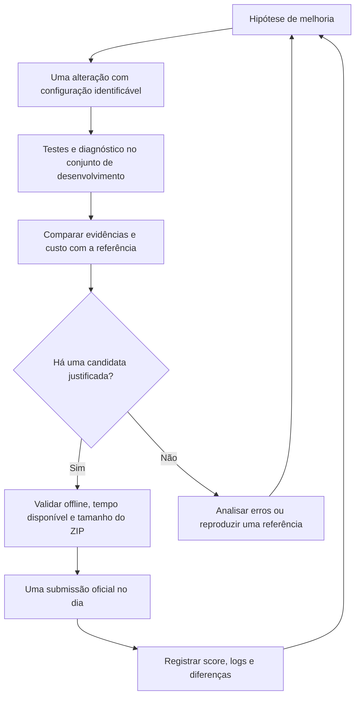
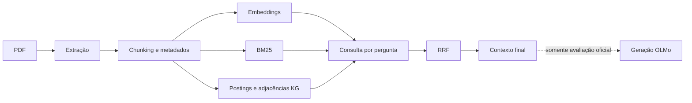
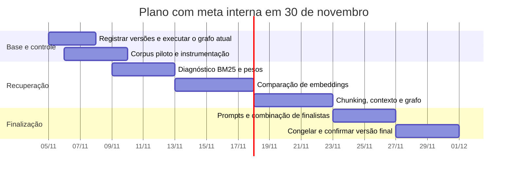

# Plano de experimentos até 30 de novembro de 2026

Planejamento registrado em 5/11/2026. Hardware disponível informado: RTX 4050
com 6 GB de VRAM e 16 GB de RAM. O OLMo 32B não será executado localmente neste
plano; a máquina local será usada para documentos, embeddings e recuperação.

## Prazo e submissões

A [regra oficial de submissão](https://cis.taskforce.ieee.org/gpais/tc-domain-qa-llms/join-the-challenge/)
consultada em 5/11 limita a frequência a **uma submissão por dia por equipe**.
O [calendário oficial](https://cis.taskforce.ieee.org/gpais/tc-domain-qa-llms/timeline/)
mostra 5/12/2026 como prazo final. Mantemos **30/11 como meta interna**, conforme
solicitado, sem depender dos dias adicionais. Não planejar duas submissões
diárias sem uma alteração explícita da regra pelos organizadores.

De 5 a 30/11 há até 26 oportunidades diárias teóricas, descontando o que já tiver
sido usado. O objetivo é produzir uma candidata informativa por dia, com testes
locais anteriores. Reservar os últimos três dias para confirmação e correções,
em vez de introduzir componentes novos.

## Ponto de partida

Resultados informados pelo usuário, não reproduzidos localmente:

| Variante | Acurácia informada |
| --- | ---: |
| RAG semântico | 57 |
| RAG semântico + BM25 | 47 |
| RAG semântico + BM25 + KG por menções/aliases | 57 |
| Versão com expansão do grafo | Pendente |

O baseline semântico permanece como referência competitiva. Os resultados não
demonstram superioridade do BM25 ou do KG; também não revelam se o empate em 57
corresponde às mesmas perguntas corretas. Congelar os arquivos das versões já
avaliadas antes de produzir novas candidatas.

A [avaliação oficial](https://cis.taskforce.ieee.org/gpais/tc-domain-qa-llms/evaluation/)
usa correção binária por pergunta e acurácia balanceada entre os dois domínios.
O leaderboard público usa metade do benchmark, enquanto o ranking definitivo
usa o conjunto completo. Tratar o leaderboard como uma medição parcial e evitar
ajustes repetidos apenas para elevar esse número. Reportar métricas locais por
domínio e a média de ambos, além do agregado.

## Fluxo de decisão



## 1. Base local de documentos e perguntas

Consultas sugeridas por tema e candidatos a distratores estão no
[guia de buscas do corpus](corpus-search-guide.md).

### Construção em duas etapas

**Piloto:** 20 PDFs, sendo oito sobre IFMIF-DONES/física relacionada, oito de IA
e quatro distratores. Criar cerca de 30 perguntas próprias, cobrindo as cinco
categorias e os dois domínios. Usar o piloto para depurar coleta, extração,
anotações e medição; não para anunciar resultados representativos.

**Base de trabalho:** ampliar para 40–60 PDFs e 60–80 perguntas se o esforço de
anotação permitir. Manter os domínios equilibrados e incluir documentos
relacionados que não respondem à pergunta, pois recuperar entre documentos muito
distintos torna o teste artificialmente fácil.

Priorizar PDFs públicos em fontes listadas no
[sites.txt](../../starter-kit/IEEE-CIS-DSQA-Starter-Kit/sample/sites.txt):

- IFMIF-DONES: JACoW/AccelConf e Eurofusion, com artigos sobre acelerador, lítio,
  diagnóstico de feixe, ativação, manutenção e proteção radiológica.
- IA: arXiv, OpenReview, ACL Anthology, NeurIPS e JMLR, com temas de modelos de
  espaço de estados, aprendizado federado, explicabilidade, métodos fuzzy e
  avaliação experimental. Variar os temas além das 25 perguntas públicas.

Não é necessário cobrir todos os sites. Preferir diversidade técnica e acesso
ao texto completo a uma coleta volumosa. Separar artigos de versões duplicadas
ou preprints do mesmo trabalho.

### Manifesto, evidências e divisão

Guardar para cada PDF: URL, título, domínio, data de obtenção, licença quando
informada, SHA-256, número de páginas e grupo do artigo/versões. Para cada pergunta:
ID, domínio, categoria, resposta de referência e todas as evidências necessárias.

Anotar as evidências por documento, página/seção e passagem literal. Depois,
mapear essas passagens para os chunks de cada configuração. Não usar apenas IDs
de chunks como verdade de referência, porque eles mudam ao alterar o chunking.
Em perguntas comparativas ou de múltiplas evidências, identificar cada trecho
necessário, inclusive tabelas e equações.

Separar aproximadamente 60%/20%/20% entre desenvolvimento, validação e teste,
agrupando por artigo e suas versões. Ajustes usam desenvolvimento; validação
seleciona finalistas; o teste fica reservado para poucos marcos. Preservar, quando
possível, equilíbrio de domínio e categoria. A amostra pequena limita a precisão
das métricas; acompanhar também casos individuais de melhora e regressão.

As 25 perguntas oficiais já influenciaram sementes e aliases do projeto.
Usá-las como teste de sanidade, não como conjunto independente de generalização.
Não criar toda a nova base como paráfrases dessas perguntas.

### Estrutura proposta para implementação futura

```text
data/local_eval/
  documents.jsonl
  pdfs/
  questions.jsonl
  evidence.jsonl
  splits.json
experiments/
  configs/
  runs/<run_id>/
    config.json
    timings.json
    retrieval.jsonl
    metrics.json
    error-notes.md
```

PDFs, caches, pesos e ZIPs devem ficar fora do versionamento de código. Essa
estrutura é uma proposta; o runner e a coleta ainda não estão implementados.
O corpus local serve para pesquisa e não precisa entrar no ZIP de avaliação,
que recebe o corpus oculto pela interface oficial.

## 2. Instrumentação antes de otimizar



Medir separadamente:

- Carga dos modelos auxiliares e do KG; processamento de cada PDF, chunking e
  quantidade de páginas/chunks; PDFs que falham ou produzem pouco texto.
- Embeddings: tempo total, quantidade de chunks, tokens truncados e throughput.
- Construção do BM25, reconhecimento de entidades e adjacências do grafo.
- Por pergunta: codificação, cada busca, RRF, tokenização/montagem do contexto.
- Pico de RAM e VRAM, mediana/p95 dos tempos por pergunta e tamanho do ZIP.

Separar execução fria e execução com caches. Os caches locais de texto e
embeddings aceleram experimentos, mas não devem ocultar o custo da avaliação:
ela inclui extração do corpus desconhecido, carga dos índices/modelos e geração.
Caches precisam de chaves com hashes do PDF, extrator, chunking, modelo e prefixos.

Começar com uma tarefa de PDF por vez, um modelo de embedding por vez e batch
pequeno, por exemplo oito textos na GPU. Aumentar somente após medir memória.
Como metas locais iniciais, buscar RAM abaixo de 12 GB e VRAM abaixo de 5 GB;
são margens de engenharia a validar, não limites já comprovados.

Medir curvas com aproximadamente 10, 30 e 60 documentos para detectar crescimento
de custo. Incluir PDFs longos e tabelas. Não converter diretamente o tempo da
RTX 4050 para uma previsão de H100. Para a execução oficial, buscar margem abaixo
de 60 minutos, por exemplo meta de 50 minutos baseada nos logs reais disponíveis.

## 3. Métricas locais sem executar OLMo

| Camada | Verificação |
| --- | --- |
| Extração | A passagem de referência, tabela ou equação foi preservada? |
| Documento | O documento correto aparece entre os primeiros candidatos? |
| Chunk | Recall de evidências em top-5/10/20 e MRR@10 |
| Múltiplas evidências | Todas as passagens necessárias foram recuperadas? |
| Contexto | As evidências sobreviveram ao orçamento final de tokens? Quanto contexto é redundante? |
| Operação | Tempos por etapa, falhas de PDFs, RAM, VRAM e tamanho |

Recall de evidências e cobertura do contexto são os principais sinais locais.
Um resultado relevante no ranking não garante que ele caiba no contexto final.
nDCG só deve ser usado se houver julgamentos de relevância adequados. Avaliar
manualmente amostras dos casos que melhoram e pioram, por domínio e categoria.

Sem OLMo, não afirmar acurácia final das respostas. Um modelo menor pode ajudar
em um teste de integração, se necessário, mas não substitui a avaliação do modelo
oficial. Separar erros de extração, ranking, seleção de contexto e geração; a
última camada só será observada em avaliações que efetivamente executem o OLMo.

## 4. Diagnosticar primeiro a regressão do BM25

Antes de acrescentar componentes, padronizar o experimento:

1. Preservar o ZIP/código exato das três submissões já avaliadas e coletar seus
   IDs, logs, duração, score sem arredondamento e configuração quando disponíveis.
2. Acrescentar uma configuração explícita de recuperação **somente semântica**
   no runner futuro. Hoje `KG_MODE=off` ainda mantém BM25; não é o baseline denso.
3. Comparar canais mantendo embedding, extração, chunking, prompt, ordem de
   contexto e orçamento iguais. As versões recentes também mudaram referências
   de fonte e contagem de tokens; isso pode confundir uma comparação histórica.
4. Inspecionar se chunks promovidos pelo BM25 substituem evidências melhores,
   se há termos científicos/siglas fragmentados e se o contexto fica redundante.

Experimentos locais em sequência, sem cruzar todas as combinações:

- Denso isolado como referência; BM25 isolado para diagnóstico.
- Denso + BM25 com pesos BM25 0,1 / 0,25 / 0,5 / 1, mantendo `k_RRF=60`.
- Só depois, se útil, comparar `k_RRF=20` e 60 e profundidades 50/100.
- Denso + KG, sem BM25, para isolar a contribuição do reconhecimento de entidades.
- Comparar `off`, `mentions` e `graph` na melhor configuração comparável.

O suporte a pesos/modos independentes precisa ser implementado; os valores acima
não são todos configuráveis no código atual. Não concluir que BM25 é sempre ruim
ou que o KG melhorou o baseline com base apenas nos três scores agregados.

## 5. Embeddings: dois candidatos, medidos em etapas

Comparar o MiniLM atual com dois candidatos iniciais:

| Modelo | Motivo para testar | Cuidado |
| --- | --- | --- |
| `BAAI/bge-base-en-v1.5` | Alternativa de recuperação em inglês com 768 dimensões | Avaliar a instrução recomendada na pergunta e preservar documentos sem ela |
| `intfloat/e5-base-v2` | Outra família de recuperação em inglês, também com 768 dimensões | Usar os prefixos `query: ` e `passage: ` corretamente |

Fontes primárias: [model card BGE](https://huggingface.co/BAAI/bge-base-en-v1.5)
e [model card E5](https://huggingface.co/intfloat/e5-base-v2). São candidatos,
não melhorias presumidas para os domínios da competição.

Testar primeiro cada modelo com busca densa isolada e o mesmo corpus/perguntas.
Comparar qualidade, tempo de indexação em CPU/GPU, memória, limite de sequência,
truncamento de chunks e tamanho real após salvar/compactar os arquivos necessários.
Depois combinar o vencedor com os demais canais. Se o modelo base não couber ou
ficar lento, considerar BGE-small como alternativa de custo, sem ampliar a busca
para muitos modelos nesta fase.

Há cerca de 600 MB entre o ZIP atual e o limite decimal de 1 GB, mas espaço em
disco não garante compatibilidade ou velocidade. **Substituir** o MiniLM ao testar
um encoder novo, evitando empacotar todos os candidatos. Manter apenas um formato
de pesos necessário e medir o ZIP; usar 900 MB como meta de margem, a validar.

Trocar o encoder exige reconstruir embeddings de documentos e perguntas, com
normalização/prefixos consistentes. O KG atual usa menções e arestas, não
embeddings próprios, portanto não precisa de novos vetores de entidades.

## 6. Chunking, extração e contexto

Após selecionar uma configuração inicial de recuperação:

- Comparar o chunking atual por caracteres com chunks por tokens/seções,
  observando o limite do encoder e evitando que parágrafos longos sejam truncados.
- Testar poucas opções de tamanho/sobreposição, mantendo o restante fixo.
- Comparar orçamento de contexto de 3k, 6k e 10k tokens pelas evidências efetivamente
  incluídas; a qualidade da resposta e a geração serão verificadas oficialmente.
- Avaliar deduplicação de chunks sobrepostos e limitação de redundância por
  documento, preservando múltiplas evidências quando necessárias.
- Se Docling dominar o tempo, comparar extração mais simples com PyMuPDF em uma
  amostra controlada e verificar perda de tabelas/equações antes de adotá-la.

Um reranker pequeno é uma hipótese posterior, caso a evidência esteja no top-50
mas não no contexto. Ele compete por tempo e espaço no ZIP; não adicioná-lo em
paralelo à troca de embeddings ou antes de diagnosticar esse erro específico.

## 7. Prompts: depois de estabilizar as evidências

Reservar duas ou três candidatas curtas com o mesmo contexto selecionado:

- Prompt atual como controle.
- Orientação para priorizar as passagens, distinguir resultados específicos
  do artigo de conhecimento geral e responder diretamente à pergunta.
- Ajustes pequenos por necessidade: passos matemáticos e unidades em perguntas
  procedimentais, critérios explícitos em comparações e incerteza quando faltar
  suporte. Não presumir acesso ao rótulo de categoria na avaliação.

Evitar aumentar o número de chamadas ao OLMo nesta fase. Sem execução local do
modelo oficial, usar revisão humana dos prompts e as submissões para medir o
efeito real. Manter limites de resposta/contexto e pipeline de recuperação fixos
durante esse teste.

## Calendário de trabalho



| Período | Prioridade local | Candidatas oficiais |
| --- | --- | --- |
| 5–8/11 | Registrar resultados, piloto, medir custos e congelar referência | Expansão do KG atual e referência comparável |
| 9–12/11 | Explicar a queda do BM25; reduzir pesos; criar validação independente | Melhor peso/canal e variantes de KG justificadas |
| 13–17/11 | Comparar MiniLM/BGE/E5; ampliar base se possível | Encoders promissores, inicialmente sem outras alterações |
| 18–22/11 | Tamanho de chunk, truncamento, redundância, contexto e limites do grafo | Vencedores locais, alterando um fator por vez |
| 23–26/11 | Prompts curtos e combinação dos melhores componentes | Poucas variantes de prompt e finalistas |
| 27–30/11 | Execução fria, tamanho, logs, integridade e documentação | Confirmar/restaurar melhor versão e manter reserva para falhas |

As datas ordenam prioridades, não obrigam a enviar variantes inferiores. Um
resultado oficial ruim antecipa diagnóstico; um ganho local pequeno sem evidência
suficiente não justifica combinar várias mudanças. Escrever desde a segunda
semana a descrição metodológica de quatro páginas exigida, com ablações e
limitações; não deixar essa entrega para o último dia.

## Registro mínimo de cada tentativa

Guardar ID, hipótese, configuração completa, commit ou snapshot, SHA-256 do ZIP,
encoder/revisão/prefixos, hashes dos dados locais, métricas por domínio, tempos,
RAM/VRAM, tamanho, score oficial e logs. Valores desconhecidos ficam como
desconhecidos. Os resultados anteriores estão em
[submission-results.md](../reports/submission-results.md).

Antes de enviar: rodar os testes, conferir carregamento offline e reproduzir o
experimento local associado. Conservar o melhor ZIP anterior para restauração.
O objetivo dos próximos dias é tornar cada tentativa interpretável e reduzir
a dependência de ajustes guiados apenas pelo leaderboard.
