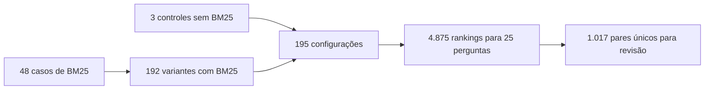

# Grade BM25 — 7/11/2026

Executada com os [arquivos de configuração](../../experiments/configs/bm25-grid.json)
e o [executor de grades](../../tools/run_experiments.py), em CPU, com caches de
texto e embeddings já disponíveis. OLMo não foi carregado.

## Escopo e resultados operacionais

- 54 PDFs e 3.885 chunks, os mesmos do piloto anterior.
- 25 perguntas públicas.
- Quatro pré-processamentos, quatro valores de `k1` e três de `b`: 48 casos BM25.
- Quatro variantes com BM25 por caso e três controles sem BM25: 195 configurações.
- 4875 rankings, top-10 por configuração/pergunta.
- 1017 pares pergunta/chunk no pool único de revisão, todos não julgados.
- Tempo total observado: 82.67 segundos, incluindo preparação
  com cache, importações, índices, consultas e exportação. Não mede execução fria
  ou geração pela LLM; tampouco é uma previsão de tempo na H100.

## Pré-processamento observado

| Cenário | Stopwords na lista efetiva | Total de tokens no corpus | Vocabulário |
| --- | ---: | ---: | ---: |
| normalized | 0 | 497811 | 23252 |
| stemming | 0 | 497811 | 18247 |
| stopwords | 318 | 333370 | 22977 |
| stopwords_stemming | 318 | 333370 | 18047 |

O stemming reduziu o vocabulário e a remoção de stopwords reduziu a quantidade
de tokens, conforme esperado dessas transformações. Isso não demonstra ganho
de relevância ou de qualidade das respostas.

## Verificações

- A configuração normalizada `k1=1.5, b=0.75` e o controle semântico reproduziram
  os 100 rankings do piloto anterior, na mesma ordem de IDs de chunks.
- Confirmados 195 pares distintos caso/variante e 4.875 registros de ranking.
- Pool sem pares pergunta/chunk duplicados, com texto e hashes correspondentes
  ao corpus preparado.
- Campos de relevância permanecem vazios; métricas de qualidade são `null`.
- Suíte de 80 testes passou, incluindo pré-processamento, validação de parâmetros,
  leitura de JSON, flags de override e controles sem BM25.

## Revisão

[Abrir índice](../../experiments/runs/bm25-grid-2026-11-07/review.md) ·
[Julgamentos compartilhados](../../experiments/runs/bm25-grid-2026-11-07/judgments.csv) ·
[Suficiência por configuração](../../experiments/runs/bm25-grid-2026-11-07/answerability.csv) ·
[Comparações com controles](../../experiments/runs/bm25-grid-2026-11-07/comparisons.csv)

Arquivos de resultados são locais e ignorados pelo Git. O índice permite abrir
cada configuração, e as tabelas apontam para o texto integral dos chunks por
pergunta. Mudança de top-1 e Jaccard mostram alterações em relação ao controle,
não acertos ou erros. A escolha de uma candidata depende dos julgamentos.
