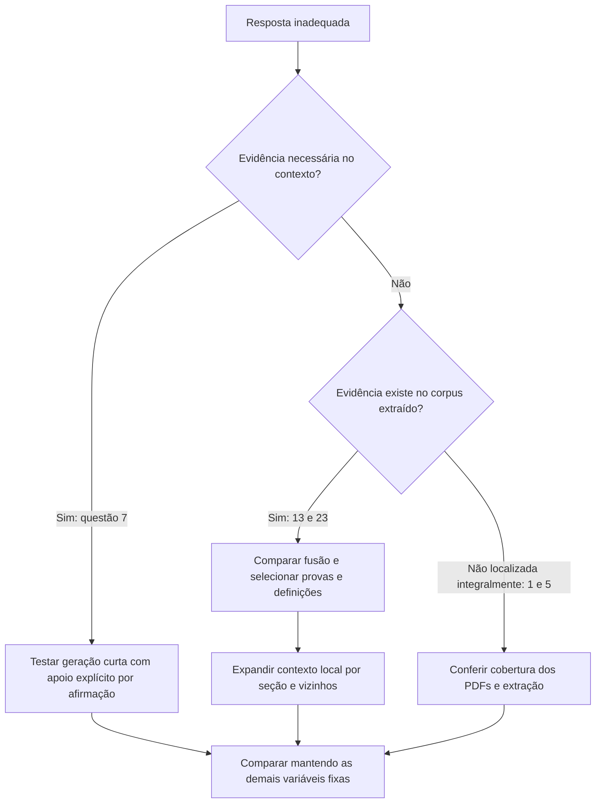

# Análise das cinco respostas: graph + stopwords + stemming

Após a chegada das outras variantes, consulte também a
[comparação entre hybrid, mentions e graph](hybrid-mentions-graph-selected-five-2026-11-07.md).

## Resultado principal

A execução encontrou material tematicamente relacionado, mas não produziu uma
resposta plenamente correta e sustentada para nenhuma das cinco perguntas na
leitura manual abaixo. A questão 1 é parcialmente compatível; as outras contêm
erros ou omissões centrais. Isso é uma avaliação qualitativa deste pequeno
recorte, não uma acurácia oficial nem uma estimativa do benchmark oculto.

Há problemas distintos: uso incorreto de evidência disponível (7), cobertura
insuficiente do contexto e invenção de detalhes (1 e 5), perda de passagens úteis
na fusão e fragmentação de demonstrações (13 e 23). Não há evidência para atribuir
as falhas ao limite de tokens ou à quantização isoladamente.

## Fontes e condições

- [Respostas recebidas](../../experiments/runs/selected-five-stopwords-stemming-2026-11-07/results_llm/graph_answers.json).
- [Perguntas e chunks exportados](../../experiments/runs/selected-five-stopwords-stemming-2026-11-07/llm_inputs/graph.json).
- [Rankings de todas as variantes](../../experiments/runs/selected-five-stopwords-stemming-2026-11-07/retrieval.jsonl).
- [Chunks de todo o corpus](../../experiments/runs/selected-five-stopwords-stemming-2026-11-07/chunks.jsonl).
- [Referências fornecidas](../../starter-kit/IEEE-CIS-DSQA-Starter-Kit/sample/sample_qa.json).

Modelo: `allenai/Olmo-3-7B-Instruct`, NF4 de 4 bits com dupla quantização e cálculo
em BF16. Geração: `do_sample=false`, contexto até 10.000 tokens e saída até 2.048.
O prompt registrado coincide com o prompt do JSON de entrada: inclui instruções
para verificar premissas, reconhecer evidência insuficiente e não fabricar fatos.
Portanto, simplesmente adicionar essas mesmas instruções não resolveria uma
ausência de orientação no prompt; elas já estavam presentes.

BM25: `k1=1.2`, `b=0.75`, remoção de 318 stopwords e Porter stemming. A fusão usa
pesos semântico/BM25/KG de `1/1/0.5` e RRF `k=60`. Os IDs de chunks registrados
nas respostas coincidem, na ordem, com os dez chunks de cada entrada `graph`.

| ID | Tokens de contexto | Tokens de saída | Chunks omitidos/truncados |
| --- | ---: | ---: | --- |
| 7 | 2.654 | 82 | 0 / 0 |
| 1 | 1.936 | 259 | 0 / 0 |
| 5 | 2.793 | 776 | 0 / 0 |
| 13 | 2.545 | 1.543 | 0 / 0 |
| 23 | 4.115 | 834 | 0 / 0 |

Todos os dez chunks foram enviados, segundo o registro. Nenhuma saída chegou ao
limite configurado. Aumentar esses limites não corrige os problemas observados.

## Julgamento por pergunta

| ID | Compatibilidade com a referência | Evidência nos chunks enviados | Diagnóstico |
| --- | --- | --- | --- |
| 7 | Temperatura correta, premissa central errada | Suficiente para corrigir a premissa e responder | Falha de uso da evidência |
| 1 | Parcialmente compatível | Excitação está descrita; a comparação física completa não está | Cobertura insuficiente e explicação adicional imprecisa |
| 5 | Incompatível no método de cálculo | Descreve inventário e purificação, sem o método requerido | Recuperação temática e alucinação de equações |
| 13 | Não apresenta o argumento requerido e faz inferências indevidas | Artigo correto, mas faltam os passos centrais da construção | Ranking, contexto da prova e extração matemática |
| 23 | Incompatível em pontos teóricos centrais | Contexto geral, sem a definição disponível no corpus | Ranking e generalização sem suporte |

### Questão 7 — armadilha de nitrogênio

A resposta afirma que a armadilha **on-line** opera a 500–600 °C. A referência
exige corrigir essa premissa: a armadilha de nitrogênio é **off-line** e opera
nessa faixa.

`DONES-001.pdf#11` (rank 1) descreve purificação no Dump Tank, em condição
estática, antes da partida e depois das paradas para manutenção, além da
temperatura. `DONES-029.pdf#40` (rank 4) diz explicitamente que ela foi transferida
para o Dump Tank como uma armadilha off-line. `DONES-001.pdf#12` descreve outras
armadilhas on-line, para oxigênio/carbono e hidrogênio; não sustenta chamar a
armadilha de nitrogênio de on-line.

Os chunks eram suficientes. O modelo extraiu a temperatura, mas conservou uma
premissa contradita pelo contexto. A resposta também atribui a faixa aos
fragmentos 1 **e 2**, embora o segundo descreva outras temperaturas e armadilhas.

Resposta compatível: “Não há uma armadilha de nitrogênio on-line nessa
configuração; a armadilha quente é off-line e opera nominalmente a 500–600 °C.”

### Questão 1 — cintilação versus OTR

A resposta identifica absorção de energia, excitação e emissão de fótons, que
é compatível com o núcleo da referência: **deposição de energia no material**.
Entretanto, acrescenta uma descrição imprecisa da OTR como passagem próxima de
um meio denso e movimento relativístico relativo ao meio, sem identificar
claramente o cruzamento da interface entre meios com propriedades dielétricas
diferentes. A resposta se alonga e perde precisão.

`DONES-026.pdf#5` (rank 3) e `DONES-025.pdf#4` (rank 4) descrevem excitação e
desexcitação de átomos/moléculas do gás em monitores de fluorescência. Os demais
chunks citam diagnósticos e OTR, sem explicar suficientemente seu mecanismo.
Fluorescência de gás é evidência relacionada, mas não documenta sozinha toda a
comparação pedida. A busca no texto dos 3.885 chunks não encontrou a palavra
`scintillation`; isso indica uma lacuna no texto extraído, sem provar ausência
do conceito em toda figura ou PDF original.

Os chunks podem sustentar parte da explicação sobre excitação. Não há um teste
sem contexto para afirmar quanto da resposta veio deles ou do conhecimento
prévio do modelo.

### Questão 5 — cálculo dos inventários

A referência pede cálculos de ativação com FISPACT-II e espectros de deutêrons
e nêutrons obtidos com MCNP6.2, com hipóteses sobre produção, decaimento e ausência
de remoção por armadilhas nas estimativas descritas. Nada disso é explicado pela
resposta gerada.

O rank 1, `DONES-029.pdf#39`, menciona aproximadamente 150 mg de Be-7 como
**inventário de equilíbrio após um ano**, e cerca de 4 g/ano de trítio. O modelo
transforma o primeiro valor em taxa anual de geração e inventa fórmulas baseadas
em tempo de circulação e eficiência das armadilhas. Uma taxa de massa por tempo
dividida por outro tempo tem dimensão de massa por tempo ao quadrado, não de
inventário. A quantidade de equilíbrio também não é, por si só, uma taxa anual.

Os chunks sobre armadilhas e vazão explicam o sistema, não o método de cálculo
perguntado. O valor de 4 g/ano tem suporte nesse documento, mas não deve ser
confundido com o inventário calculado de aproximadamente 1,47 g na referência,
que se refere a hipóteses e estimativas específicas.

Há material metodológico relacionado fora do contexto enviado:
`DONES-008.pdf#23` trata de transporte/ativação e fica em 4º no BM25;
`DONES-008.pdf#43`, sobre inventários de ativação, fica em 3º;
`DONES-027.pdf#15` menciona FISPACT para espectros gama e fica em 10º.
Nenhum dos três entra no top 10 de `graph`. Esses trechos poderiam melhorar a
fundamentação, mas não devem ser apresentados como prova de todos os detalhes
específicos da resposta de referência.

Buscas textuais por `VITAMIN`, `5.53` e pelos valores/metodologia específicos
não localizaram a passagem completa da referência no corpus extraído. A
cobertura dessa fonte precisa ser verificada antes de exigir uma reprodução
detalhada da referência. Com o contexto atual, a geração deveria explicitar que
não dispõe do método de cálculo, em vez de inventar equações.

### Questão 13 — por que Y é lush

O modelo encontra o artigo certo, mas dá uma explicação circular (“Y é lush
porque satisfaz a definição”) e sugere uma herança por inclusão/separabilidade
que não é justificada pelo teorema citado. A afirmação de que existe um subespaço
lush contendo E não demonstra que todo subespaço dele seja lush.

A referência requer o argumento específico: pares densos em `S_Y × S_Y`,
repetidos infinitamente, construção com `ε_m=1/m`, vetores testemunhas dentro de
Y e extensão por aproximação para todos os pares.

O contexto contém o enunciado e o começo da demonstração, mas perde sua sequência:

| Chunk do mesmo artigo AI-007 | Conteúdo | Rank BM25 |
| --- | --- | ---: |
| #35 | Construção de E_m, pares e ε_m | 17 |
| #36–37 | Testemunhas, extensão de E_m e construção de Y | 78 / 77 |
| #38 | Densidade, repetição infinita e conclusão | 31 |
| #39 | Fim da conclusão, depois comentário sobre outro resultado | 2 |

Nenhum deles entra no top 10 de `graph`. O `#39` entra em 5º no híbrido sem KG,
com rank semântico 19 e BM25 2; a inclusão do KG o retira do top 10. Existe,
portanto, uma perda de evidência identificável na fusão, mesmo sem executar outra
LLM. Isso não demonstra, por si só, que o híbrido geraria uma resposta correta.

O contexto enviado também contém **dez ocorrências de `formula-not-decoded`**.
É uma falha de extração independente do ranking. O texto de `#38` já permitiria
explicar a ideia principal mesmo sem recuperar todas as fórmulas, mas uma prova
rigorosa requer conferir a extração contra o PDF.

### Questão 23 — resiliência (α,f)

A resposta trata α como uma tolerância genérica, sugere que α=0,1 poderia
significar 10% de erro e afirma que Krum e outras regras normalmente não têm
garantias formais contra clientes maliciosos. Isso conflita com a referência e
com o próprio material recuperado: `AI-018.pdf#1` descreve Krum como uma regra
que satisfaz uma propriedade de resiliência com garantia de convergência.
A resposta também aproxima FLTrust de blockchain sem evidência para essa
associação no contexto enviado.

O ponto requerido é um **enquadramento teórico comum**, não uma alegação de
superioridade geral sobre os métodos de fora da família. A definição controla
alinhamento esperado com o gradiente e momentos de ordens 2, 3 e 4; α tem
interpretação angular, não uma porcentagem arbitrária de erro.

`AI-018.pdf#22` contém a definição e as condições centrais, mas está em **16º no
BM25** e não entra no contexto de nenhuma das sete variantes. `#20` (intuição
geométrica, rank 18) e `#23` (Krum satisfaz a condição, rank 17) também ficam de
fora. São candidatos acessíveis à profundidade atual de 100; aumentar a
profundidade não é o primeiro ajuste indicado.

O contexto `graph` inclui dois chunks de bibliografia, `AI-020.pdf#53` e `#54`,
nos ranks 2 e 8, e a capa de FLTrust em `AI-019.pdf#0`, no rank 3. Bibliografia
contendo títulos não substitui as definições dos artigos. O híbrido sem KG
preserva mais material de Krum, embora ainda não inclua a definição completa.

Há ainda um desalinhamento lexical verificável: `\alpha` vira o token `alpha`,
enquanto a letra grega no PDF vira `α`. Stemming não unifica esses termos.

## O que se pode concluir sobre o KG

| ID | Chunks em comum graph/mentions, de 10 | Chunks em comum graph/hybrid, de 10 |
| --- | ---: | ---: |
| 7 | 10 | 7 |
| 1 | 10 | 8 |
| 5 | 9 | 8 |
| 13 | 10 | 7 |
| 23 | 9 | 4 |

Esses números comparam conjuntos; as posições podem mudar. A expansão por
arestas altera pouco os conjuntos em relação ao uso de menções nesta amostra.
A diferença para o híbrido é maior. Não se deve atribuir toda essa diferença à
exploração do grafo: o canal de menções já participa do modo `graph`.

Para 13, o KG reconhece `Banach_space` e expande para entidades genéricas do
domínio; para 23, reconhece `Federated_learning` e expande para SGD,
reconhecimento de padrões, overfitting etc. Isso favorece afinidade temática,
sem reconhecer necessariamente o passo da prova ou a definição solicitada.
Para 7 aparecem também vizinhos como temperatura corporal e rede de água, o
que mostra que presença de uma entidade no corpus não basta para qualificá-la
como relevante à pergunta.

Há evidência para **testar menos influência do KG** e seleção mais orientada à
pergunta; não há evidência de ganho de acurácia com a configuração atual. Também
não há uma ablação de respostas que isole o efeito de stopwords, stemming,
quantização ou KG nesta execução.

## Próximos experimentos justificados

1. **Ablação de canal, mantendo modelo e prompt fixos.** Gerar respostas para
   `hybrid` e `mentions` com as mesmas cinco perguntas. Depois comparar pesos KG
   `0`, `0.25` e `0.5`, julgando a presença de evidência e a resposta, não apenas
   a mudança de ranking. O `#39` da questão 13 é um caso de regressão concreto.
   Alterar pesos não adiciona modelos nem bytes relevantes ao ZIP.
2. **Recuperar unidades de prova e definição.** Testar seleção de candidatos
   seguida de expansão limitada por seção/chunks vizinhos. Na 13, os chunks
   `#35–38` completam a prova iniciada em `#34`; na 23, buscar explicitamente a
   seção “Byzantine Resilience” e a definição em `#22`. Preservar ordem da fonte,
   deduplicar e respeitar o orçamento de contexto. Um reranker pode ajudar a
   escolher esses candidatos; sua latência e seu tamanho precisariam ser medidos
   antes de incluí-lo na submissão.
3. **Testar tratamento de conteúdo de pouco valor explicativo.** Avaliar
   penalização de bibliografia, autoria/capas e duplicação, preservando a
   rastreabilidade. Na 23 há evidência clara de gasto de posições com esse
   conteúdo. Não excluir todas as referências indiscriminadamente: às vezes a
   pergunta pode pedir justamente uma fonte.
4. **Normalização científica e cobertura.** Testar `\alpha`/`α`, formas de
   isótopos e preservação de negações como `not` e `no` em BM25. A lista atual de
   stopwords remove essas duas negações; elas continuam intactas no texto
   enviado à LLM. Portanto, isso não explica a falha de leitura da questão 7,
   cujo trecho correto já estava presente. Conferir as fórmulas da 13 e a fonte
   específica de inventários da 5 antes de alterar o embedding para compensar
   informação ausente.
5. **Teste de geração com evidência explícita e resposta breve.** Pedir primeiro
   uma resposta direta e, quando necessário, uma justificativa curta vinculada
   aos IDs dos fragmentos. Para cálculos, proibir relações não sustentadas e
   solicitar conferir unidades; para demonstrações, pedir o argumento da prova,
   não apenas o enunciado de um teorema. Usar uma instrução geral, sem inserir
   respostas esperadas ou regras feitas sob medida para os cinco IDs. A regra
   de não fabricar fatos já existe no prompt e precisa ser avaliada na prática.

Não recomendo aumentar tokens ou trocar imediatamente o embedding como primeira
ação: existem evidências relevantes já encontradas pelo BM25 e descartadas
depois, além de lacunas de extração/cobertura. Os testes baratos de fusão,
estrutura do contexto e geração devem preceder um modelo adicional. Nenhuma
mudança de inferência, parâmetros, julgamentos manuais ou ZIP foi aplicada por
esta análise.
