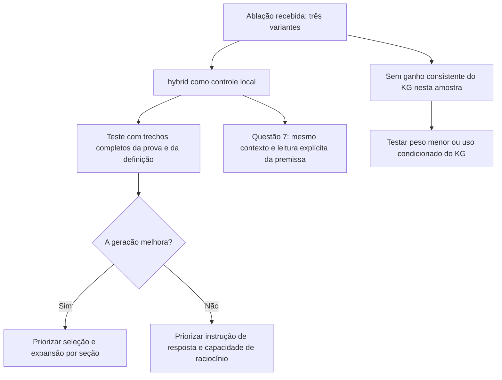

# Comparação das respostas: hybrid, mentions e graph

O teste posterior com contexto selecionado manualmente está analisado em
[Respostas com evidência manual](manual-evidence-q13-q23-2026-11-07.md).

## Conclusão

As novas respostas reforçam a necessidade de melhorar a seleção e a leitura das
evidências. **Não há ganho consistente observado com o KG neste recorte.** O
híbrido sem KG é melhor na questão 23 e mais direto no núcleo da questão 1, mas
também falha nas questões 7, 5 e 13. Portanto, retirar o KG sozinho não resolve os
problemas do pipeline.

Esta comparação complementa a
[análise inicial de graph](graph-answers-selected-five-2026-11-07.md).
Os julgamentos são qualitativos, com base nas respostas de referência e no texto
dos chunks. Não representam uma nota oficial nem uma avaliação de todo o corpus.

## Comparabilidade dos arquivos

Fontes:

- [hybrid_answers.json](../../experiments/runs/selected-five-stopwords-stemming-2026-11-07/results_llm/hybrid_answers.json).
- [mentions_answers.json](../../experiments/runs/selected-five-stopwords-stemming-2026-11-07/results_llm/mentions_answers.json).
- [graph_answers.json](../../experiments/runs/selected-five-stopwords-stemming-2026-11-07/results_llm/graph_answers.json).
- Entradas correspondentes: [hybrid](../../experiments/runs/selected-five-stopwords-stemming-2026-11-07/llm_inputs/hybrid.json),
  [mentions](../../experiments/runs/selected-five-stopwords-stemming-2026-11-07/llm_inputs/mentions.json) e
  [graph](../../experiments/runs/selected-five-stopwords-stemming-2026-11-07/llm_inputs/graph.json).

Os três arquivos registram o mesmo modelo, prompt de sistema, quantização e
configuração de geração: OLMo 3 7B Instruct, NF4 de 4 bits, cálculo BF16,
`do_sample=false`, 10.000 tokens de contexto e até 2.048 tokens de saída.
Cada execução contém as mesmas perguntas, na ordem 7, 1, 5, 13 e 23.

Os IDs e a ordem dos dez chunks registrados em cada uma das quinze respostas
coincidem com a respectiva entrada exportada. Não houve chunks omitidos ou
truncados, nem respostas que atingiram o limite de saída. Os arquivos não
registram versões do ambiente nem os tensores do prompt; a comparação se apoia
na configuração e nas fontes declaradas, sem prometer reprodução bit a bit.

As variantes significam:

- `hybrid`: semântico + BM25.
- `mentions`: semântico + BM25 + menções de entidades.
- `graph`: semântico + BM25 + menções e expansão de entidades pelo grafo.

## Comparação qualitativa

| ID | hybrid | mentions | graph | Interpretação |
| --- | --- | --- | --- | --- |
| 7 | Temperatura correta; mantém premissa on-line errada | Mesmo erro central | Mesmo erro central | Evidência suficiente, geração falha nas três |
| 1 | Explicita deposição de energia; explicação extra contém imprecisões | Excitação compatível, explicação de OTR inadequada | Excitação compatível, explicação de OTR inadequada | hybrid é mais direto no núcleo; cobertura científica ainda incompleta |
| 5 | Método inventado e atribuição indevida dos valores a IFMIF em vez de DONES | Integra produção/remoção sem demonstrar o método solicitado | Inventa equações envolvendo circulação e eficiência | Nenhuma explica os cálculos de ativação pedidos |
| 13 | Mistura renormação, inclusão de subespaços e uma falsa citação | Explicação circular: reformula a pergunta supondo a condição que precisava demonstrar | Explicação circular e suposta herança por inclusão | Nenhuma apresenta a prova por densidade e repetição |
| 23 | Reconhece Krum dentro da família e menciona direção/momentos, mas acrescenta afirmações sem suporte | Separa Krum indevidamente do enquadramento e trata α genericamente | Trata α genericamente e sugere falta de garantias para Krum | hybrid é melhor, mas ainda não é uma resposta completa e rigorosa |

### Questão 7: a falha persiste com evidência suficiente

Nas três entradas, `DONES-001.pdf#11` aparece em primeiro e
`DONES-029.pdf#40` em quarto. O primeiro informa operação em condição estática,
antes da partida/depois das paradas; o quarto declara explicitamente a
armadilha de nitrogênio como **off-line**. Todas as respostas extraem 500–600 °C
e repetem o “on-line” da pergunta.

Aqui a ablação enfraquece a hipótese de que retirar o KG resolveria o erro.
Cabe testar uma geração que confira o qualificativo da pergunta antes de
responder, mantendo esses mesmos chunks. A instrução genérica para identificar
premissas contraditas já consta do prompt; não foi suficiente nesta execução.

### Questão 1: conteúdo relacionado não garante precisão física

`hybrid` escreve explicitamente que as partículas **depositam energia** e
excitam os elétrons do material, atendendo ao núcleo da referência. As outras
duas respostas descrevem excitação/absorção, mas não são tão diretas.

Nenhuma mantém a explicação restrita a esse contraste. O híbrido acrescenta
qualificações sobre coerência e gradientes de densidade sem sustentação nos
chunks; `mentions` fala de transições em átomos vizinhos para explicar OTR;
`graph` fala de passagem próxima de um meio denso. Os chunks principais
documentam fluorescência do gás e o uso de OTR em diagnósticos, sem uma
explicação completa da comparação física. Uma resposta curta reduziria o espaço
para essas extrapolações, mas isso ainda precisa ser testado.

### Questão 5: retirar o KG não recuperou o método necessário

Todas as variantes priorizam a descrição do sistema de impurezas e o trecho
`DONES-029.pdf#39`, com aproximadamente 150 mg de Be-7 no equilíbrio e cerca de
4 g/ano de trítio. Nenhuma inclui os trechos metodológicos de ativação apontados
na análise anterior, nem explica FISPACT-II/MCNP como na referência.

As alucinações mudam: `graph` divide quantidades/taxas por tempos;
`mentions` propõe integração de produção menos remoção, tratando o inventário
de 150 mg como taxa anual; `hybrid` inventa uma fórmula com Bq, massa e tempo,
e atribui os números a IFMIF, alegando que não são diretamente DONES. Essa
separação não é sustentada pelo trecho fornecido.

O reconhecimento de que faltam números em parte da resposta híbrida não torna
válido o método inventado. É preciso melhorar a cobertura/seleção de fontes e
testar abstinência de cálculos sem suporte, não escolher a equação que parece
mais plausível entre as três.

### Questão 13: recuperar parte da conclusão não bastou

O híbrido inclui `AI-007.pdf#39` em quinto, começando com a conclusão sobre pares
de um conjunto denso e epsilons arbitrariamente pequenos. `mentions` e `graph`
não incluem esse trecho. A hipótese anterior de perda de evidência com KG se
confirma no contexto, mas **não se converteu em resposta correta no híbrido**.

O híbrido atribui ao fragmento 5 uma citação extensa que mistura o texto sobre
Asplund com afirmações sobre renormação e Lemma 3.1 ausentes desse fragmento.
Depois tenta justificar a propriedade por norma herdada/inclusão. `mentions`
reformula a pergunta acrescentando a suposição de que Y já satisfaz as condições
do teorema, evitando demonstrar o ponto pedido. `graph` também não demonstra o
passo por densidade, repetição infinita e aproximação.

O conjunto coerente `AI-007.pdf#35–38` continua fora das três entradas. É um
caso para testar recuperação da sequência da prova, em vez de fornecer somente
enunciados e um final de parágrafo acompanhado de discussão de outro resultado.
As fórmulas não decodificadas permanecem um problema independente.

### Questão 23: evidência mais específica acompanha uma resposta melhor

O híbrido inclui seis chunks de `AI-018`, contra dois nas outras variantes.
Entre eles estão:

- `#9`, rank 2: alinhamento com o gradiente, controle de momentos até a quarta
  ordem e Krum satisfazendo a propriedade de resiliência.
- `#18–19`, ranks 4 e 7: impossibilidade de tolerar um único trabalhador
  bizantino usando agregação linear.
- `AI-020.pdf#18`, rank 6: relação entre noções de robustez e Krum.

A resposta híbrida reflete essas informações: apresenta Krum como uma regra
`(α,f)`-resiliente e menciona momentos e direção do gradiente. `mentions` contém
`AI-018.pdf#9`, mas apenas na décima posição, e ainda descreve Krum como um
contraste com a parametrização `(α,f)`. `graph` perde esse trecho e apresenta
uma confusão semelhante. Isso mostra a importância de seleção, posição e
conteúdo concorrente; não permite isolar apenas um desses fatores.

O híbrido ainda omite a interpretação angular precisa e acrescenta requisitos
como distribuições normais/subgaussianas e associações com blockchain que não
estão demonstrados pelos trechos citados. A definição em `AI-018.pdf#22`, rank
16 do BM25, continua ausente em todas as entradas. Assim, há melhora qualitativa
em relação ao KG, não uma solução completa da questão.

## Quantidade de contexto e de resposta

| ID | Contexto hybrid / mentions / graph | Saída hybrid / mentions / graph |
| --- | --- | --- |
| 7 | 2.440 / 2.654 / 2.654 | 94 / 93 / 82 |
| 1 | 1.994 / 1.936 / 1.936 | 233 / 268 / 259 |
| 5 | 2.575 / 2.561 / 2.793 | 951 / 749 / 776 |
| 13 | 2.767 / 2.545 / 2.545 | 1.327 / 930 / 1.543 |
| 23 | 3.517 / 4.230 / 4.115 | 668 / 578 / 834 |

Na 23, o híbrido usa menos contexto e apresenta uma explicação melhor. Na 13,
a resposta mais longa (`graph`) continua inadequada. Quantidade de tokens não é
uma medida de suficiência de evidência nem de qualidade. Não há tempos de GPU
nesses arquivos para comparar velocidade.

`mentions` e `graph` usam os mesmos conjuntos de dez chunks nas questões 7, 1 e
13, mas **em ordens diferentes**. Nas questões 5 e 23 compartilham nove de dez.
As diferenças de texto entre essas variantes não devem ser atribuídas à presença
de novas evidências quando apenas a ordem mudou.

## Decisões para o próximo experimento

1. **Usar `hybrid` como controle do próximo teste local**, preservando as outras
   variantes. É a opção mais promissora neste recorte, principalmente na 23,
   mas cinco perguntas não justificam afirmar superioridade geral ou escolher
   uma submissão apenas com esta avaliação.
2. **Fazer um diagnóstico com evidência selecionada manualmente dos PDFs**:
   fornecer a prova `AI-007.pdf#35–38` para a 13 e a definição/explicação
   `AI-018.pdf#20–23` para a 23. Manter pergunta, prompt e modelo iguais e não
   enviar a resposta esperada à LLM. Esse é um diagnóstico com seleção manual,
   não uma métrica de recuperação automática. Ele separa melhor a falta do
   trecho necessário da incapacidade de utilizá-lo.
3. **Testar seleção por seção/continuidade e reranking entre candidatos já
   encontrados.** A definição da 23 está dentro da profundidade atual de 100;
   aumentar essa profundidade não é necessário para alcançá-la. Penalização
   de bibliografia/capas deve ser uma ablação, sem apagar fontes do corpus.
4. **Testar geração curta com apoio explícito por afirmação**, começando pela 7,
   onde as três entradas já trazem evidência suficiente. Na 5, testar a
   capacidade de reconhecer que o contexto não documenta o método, em vez de
   fabricar equações. Não ajustar instruções especificamente pelos cinco IDs.
5. **Depois, medir redução/condicionamento do KG.** As confusões de 13 e 23 são
   compatíveis com menções genéricas dominando trechos específicos; a expansão
   de arestas não mostrou benefício consistente. Trocar pesos é barato; uma
   eventual inclusão de reranker ou extrator de fórmulas requer medir tempo e
   tamanho frente aos limites da competição.

Não foram alterados a inferência, os parâmetros, o ZIP nem os arquivos de
julgamento manual. Esta etapa analisou as quinze respostas fornecidas; não
executou novamente a LLM.
