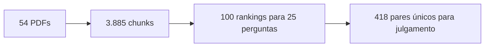

# Piloto local de recuperação — 7/11/2026

Execução de [run_retrieval.py](../../tools/run_retrieval.py) em CPU, quatro
threads, MiniLM local, Docling sem OCR/estrutura de tabelas, chunks de 800
caracteres com sobreposição de 150. São resultados de operação e exportação,
sem julgamento de relevância e sem executar OLMo.

## Dados e saídas

- 54 PDFs: 24 de IA e 30 de DONES, 717 páginas.
- 3.885 chunks; 25 perguntas públicas; quatro variantes.
- 100 rankings (25 perguntas × semântico/híbrido/menções/grafo), top-10 por ranking.
- 418 pares pergunta/chunk distintos na união dos candidatos, todos não julgados.
- Zero PDFs com falha ou conversão parcial nesta execução.
- Catálogo de IA com quatro PDFs ausentes: AI-008, AI-010, AI-011 e AI-015.

[Abrir revisão por pergunta](../../experiments/runs/pilot-2026-11-07/review.md) ·
[CSV de julgamento](../../experiments/runs/pilot-2026-11-07/judgments.csv) ·
[CSV de suficiência do conjunto](../../experiments/runs/pilot-2026-11-07/answerability.csv)

Esses links apontam para resultados locais gerados, ignorados pelo Git. O
[guia de implementação](../implementations/local-retrieval-review.md) explica
como reproduzi-los e interpretar os arquivos.

## Tempos observados

| Etapa | Primeira rodada completa | Repetição com cache |
| --- | ---: | ---: |
| PDFs e chunking | 677.35 s | 13.74 s |
| Embeddings dos documentos | 110.65 s | 0.01 s |
| Construção BM25 | 0.175 s | 0.196 s |
| Construção do índice KG com expansão | 0.313 s | 0.396 s |
| Sessão inteira, incluindo importações e exportação | 803.18 s | 31.05 s |
| Pico RSS do processo | 3821.9 MiB | 1234.2 MiB |

A primeira rodada não é inteiramente fria: reutilizou Markdown de dois PDFs
processados no ensaio de integração; os demais 52 foram extraídos. Os embeddings
foram calculados. A segunda rodada reutilizou os 54 textos e a matriz de vetores.
Os 100 rankings preservaram os mesmos IDs e a mesma ordem de chunks; os arquivos
`chunks.jsonl` foram idênticos. Os tempos incluem trabalho compartilhado pelas
quatro variantes, sem geração de respostas, e não estimam uma execução na H100.

## Observação sobre truncamento

745 de 3885 chunks
(19.2%) ultrapassam o limite de
sequência do encoder atual. O texto completo foi preservado nos arquivos de
revisão. Isso identifica um ponto de investigação para chunking/embedding,
sem demonstrar que esses trechos seriam relevantes ou que causaram erros.

## Próximo passo

Preencher os campos de julgamento e suficiência conforme o
[protocolo](../implementations/local-retrieval-review.md#protocolo-de-anotação).
Distinguir ausência de documento, falha de extração e ranking inadequado. Nenhuma
acurácia, recall ou melhoria de qualidade foi calculada a partir desta rodada.
