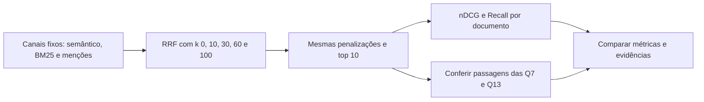

# Variação da constante do RRF — 08/11/2026

**`k=60` manteve o maior nDCG documental nos dois finalistas**, nos três recortes
de perguntas. Valores menores apresentam outras trocas: no híbrido, `k=0`
recupera mais documentos nota 2; com menções, `k=0` e `k=10` trazem de volta a
conclusão da prova da Q13. Essas diferenças justificam conferir o conteúdo dos
chunks antes de escolher uma configuração para geração.

Artefatos: [`rrf-k-public25-2026-11-08`](../../experiments/runs/rrf-k-public25-2026-11-08).
O teste segue a [comparação anterior de pesos](rrf-weights-public25-2026-11-08.md),
com os julgamentos corrigidos para AI-027 e os mesmos dados.

## Escopo do teste

O RRF implementado calcula, para cada chunk, `sum(peso_canal / (k + posição))`,
com posições iniciadas em 1. `k` é a constante que suaviza a influência das
posições: não é o top-k de chunks nem o `k1` do BM25. Com `k=0`, o score é a
soma ponderada dos inversos das posições; valores maiores reduzem o contraste
entre posições e dão mais espaço ao acordo entre canais.

Foram testados `k ∈ {0, 10, 30, 60, 100}` em dois finalistas:

- **Híbrido:** semântico 1 e BM25 1, sem KG;
- **Mentions:** semântico 1, BM25 1 e menções do KG 0,5.

Mantidos MiniLM, 64 PDFs, 5.093 chunks, 25 perguntas, top 10 final, profundidade
de 100 candidatos por canal, stopwords/stemming, `k1=1.2`, `b=0.75`, penalizações
de capas/referências e ausência de expansão de vizinhos/fórmulas. Os embeddings
de documentos e os textos vieram do cache. As consultas foram codificadas pelo
mesmo encoder durante as novas execuções, sem carregar LLM.



O critério de seleção foi o mesmo da rodada anterior: maior nDCG@10 nas 17
perguntas textuais; em empate, maior Recall estrito dentro dos dez chunks e
preferência por manter o valor mais próximo de 60. Não houve empate.

## Métricas nas 17 perguntas textuais

| Constante k | Híbrido: nDCG@10 | Híbrido: Recall nota 2 | Mentions: nDCG@10 | Mentions: Recall nota 2 |
| ---: | ---: | ---: | ---: | ---: |
| 0 | 0,8935 | **0,9657** | 0,8741 | 0,9314 |
| 10 | 0,8857 | 0,9167 | 0,9030 | **0,9363** |
| 30 | 0,8871 | 0,9167 | 0,9048 | 0,9167 |
| **60** | **0,8988** | 0,9461 | **0,9148** | **0,9363** |
| 100 | 0,8972 | 0,9461 | 0,9092 | **0,9363** |

Recall nesta tabela considera documentos nota 2 presentes dentro dos primeiros
dez chunks, não o número de fatos necessários cobertos. Um mesmo fato pode ser
confirmado por mais de um documento relevante; recuperar mais documentos não
significa necessariamente melhorar a resposta.

O híbrido com k=100 ficou próximo do controle: diferença de −0,0016 no nDCG.
Esse pequeno desvio em uma amostra pública não estabelece superioridade geral
de k=60. A varredura apenas não encontrou ganho agregado de nDCG sobre ele.

## Recortes de 25 e 22 perguntas

| Variante | k | nDCG@10 — 25 perguntas | nDCG@10 — 22 com evidência direta | Recall nota 2 — 22 |
| --- | ---: | ---: | ---: | ---: |
| Híbrido | 0 | 0,8474 | 0,8478 | **0,9356** |
| Híbrido | 10 | 0,8672 | 0,8528 | 0,8977 |
| Híbrido | 30 | 0,8689 | 0,8510 | 0,8977 |
| **Híbrido** | **60** | **0,8769** | **0,8601** | 0,9205 |
| Híbrido | 100 | 0,8758 | 0,8589 | 0,9205 |
| Mentions | 0 | 0,8456 | 0,8282 | 0,9091 |
| Mentions | 10 | 0,8809 | 0,8647 | **0,9129** |
| Mentions | 30 | 0,8797 | 0,8632 | 0,8977 |
| **Mentions** | **60** | **0,8865** | **0,8710** | **0,9129** |
| Mentions | 100 | 0,8818 | 0,8657 | **0,9129** |

O recorte de 22 exclui as questões 16, 18 e 21, que ainda não têm documento
nota 2. Todos os resultados usam a mesma versão corrigida dos julgamentos,
congelada em `judgments-snapshot.json`. Não são métricas de acurácia da LLM.

## Passagens recuperadas

As verificações se referem a trechos literais específicos já inspecionados;
não constituem um julgamento automático completo de suficiência.

| Variante | k | Q7: posição da faixa 500–600 °C | Q13: posição da conclusão da prova |
| --- | ---: | ---: | --- |
| Híbrido | 0 | 8 | 5 |
| Híbrido | 10 | 9 | 6 |
| Híbrido | 30 | 9 | 6 |
| Híbrido | 60 | 8 | 6 |
| Híbrido | 100 | 9 | 6 |
| Mentions | 0 | 7 | 6 |
| Mentions | 10 | 5 | 10 |
| Mentions | 30 | 5 | Ausente |
| Mentions | 60 | 5 | Ausente |
| Mentions | 100 | 6 | Ausente |

O trecho da Q7 é `DONES-001#12`. O da Q13 é `AI-007#35`, que encadeia densidade
dos pares, repetição infinita e epsilons arbitrariamente pequenos. Todas as
configurações da Q13 continuam sem os chunks 32–34, que detalham a construção
das testemunhas. Recuperar a conclusão resolve somente parte dessa lacuna.

Na Q13, todas as dez configurações obtêm nDCG documental 1. A ausência ou
presença de `#35` não aparece nessa métrica porque os chunks vêm do mesmo artigo.
Menções com k=10 recuperam a conclusão no último slot; é necessário conferir
se esse trecho chega integralmente ao contexto efetivo da LLM. Não foi executada
geração nesta rodada, portanto esse efeito não foi medido.

## Decisão e limites

Manteria **híbrido com k=60** como controle principal. Se o objetivo for comparar
menções na geração, **mentions com k=10** é uma alternativa útil: preserva o
trecho da Q13 e obtém nDCG próximo ao controle híbrido, com Recall estrito um
pouco menor. Menções com k=0 também preservam esse trecho em posição melhor,
mas perdem mais nDCG na média.

Não alterei os defaults do pipeline nem gerei um ZIP novo. Os resultados não
justificam uma troca automática do k. A avaliação de consultas longas e da
continuidade da prova continua necessária. Esta rodada não testa outras
famílias de fusão, profundidades ou a busca conjunta de k e pesos dos canais.

## Validação e reprodução

Foram feitas quatro execuções novas, cada uma gerando as duas variantes;
k=60 reutiliza os rankings da referência, reavaliados com a mesma versão dos
julgamentos. As execuções registraram cerca de 27,4–35,8 s cada, com cache de
texto e vetores e pico RSS próximo de 1,2 GiB. Não são tempos de indexação fria
ou geração na H100. Mudar k mantém o número de modelos e candidatos neste teste.

Foram conferidos IDs/hashes dos chunks e PDFs, fingerprint e configurações do
encoder, parâmetros BM25, política de evidências, versões e código, além do
hash do artefato KG. Os 2.000 scores RRF dos novos hits coincidiram com a fórmula.
Nos 1.952 hits também presentes nos rankings antigos, os ranks dos canais
compartilhados e os scores semântico/BM25 permaneceram iguais. Não se refez a
fusão apenas sobre os dez chunks antigos: cada execução usa os 100 candidatos
de cada canal. Passaram os 12 testes da base/avaliador e a validação da base.

Na [pasta do experimento](../../experiments/runs/rrf-k-public25-2026-11-08):

- `comparison.csv`, `per-question.csv` e `case-summary.json`: resultados;
- `targeted-passage-checks.json`: posições dos trechos conferidos;
- `configs/rrf-k-*.json`: configurações completas dos cinco valores;
- `runs/`: quatro execuções novas, com logs, rankings e tempos;
- `llm_inputs/rrf-k-*-hybrid.json` e `rrf-k-*-mentions.json`: contextos para o notebook;
- `metrics/`, `selected.json`, `verification.json` e `completion.json`: métricas,
  seleção e verificações;
- `judgments-snapshot.json`: versão dos julgamentos usada em todos os casos.

Para repetir uma configuração, escolhendo outra pasta de saída:

```bash
.venv/bin/python tools/run_retrieval.py \
  --config experiments/runs/rrf-k-public25-2026-11-08/configs/rrf-k-10.json \
  --output experiments/runs/rrf-k-10-NOVA-EXECUCAO
```

O campo `rrf_k` do JSON ou a flag `--rrf-k` permite outros valores não negativos.
O runner gera rankings e contextos; o cálculo de métricas continua separado,
usando `tools/evaluate_retrieval.py` com os mesmos julgamentos.
