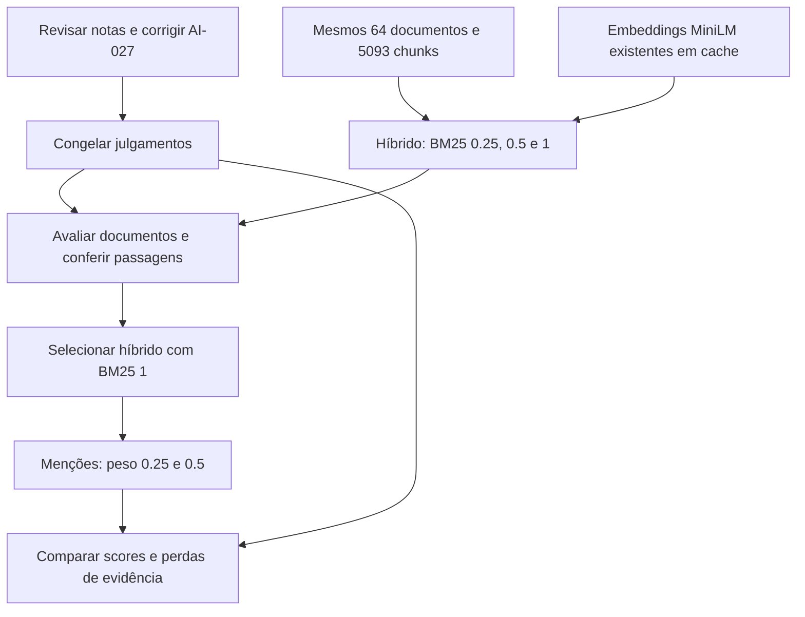

# Revisão dos julgamentos e pesos da recuperação — 08/11/2026

**O melhor híbrido entre os pesos testados continuou sendo semântico = 1 e
BM25 = 1.** Reduzir o peso lexical para 0,25 ou 0,5 piorou a ordenação documental
e retirou a temperatura da questão 7 do top 10. Menções com peso 0,5 lideraram
o nDCG, mas continuaram removendo a conclusão da prova da questão 13.

Resultados e configurações:
[`rrf-weights-public25-2026-11-08`](../../experiments/runs/rrf-weights-public25-2026-11-08).
Execução de referência:
[`all_versions_test_25quests`](../../experiments/runs/all_versions_test_25quests).

## 1. Julgamentos: o que mudou nos scores

Na revisão enviada pelo usuário, foram alteradas de 0 para 1 as notas de:

- Q6 / DONES-034: tabela do HX de IFMIF, útil como contexto para a vazão;
- Q25 / AI-025: revisão de SSMs, filtro fixo versus seleção pela entrada;
- Q25 / AI-026: entrada que deveria se referir a **AI-027**.

O usuário confirmou a correção para AI-027. AI-026 voltou a 0. Foram alinhados
rótulos, justificativas e passagens das três novas notas 1, bem como a
especificação editável `annotation-spec.json`, para que uma regeneração preserve
as decisões. A base passa a ter 97 passagens, 32 notas 1 e 38 notas 2.

Foram preservadas três versões dos resultados:

| Arquivos na execução original | Julgamentos usados |
| --- | --- |
| `metrics-*.json` | Antes da revisão dos negativos |
| `metrics2-*.json` | Revisão recebida, ainda com AI-026 |
| `metrics3-*.json` | Revisão com AI-027, após confirmação do usuário |

As mudanças de score abaixo são de **nDCG@10 documental nas 25 perguntas**.
Os rankings são idênticos entre as três colunas: somente os julgamentos mudam.

| Variante | Antes | metrics2 | metrics3, corrigido | Diferença corrigido − antes |
| --- | ---: | ---: | ---: | ---: |
| Denso | 0,8184 | 0,8216 | 0,8313 | +0,0128 |
| BM25 | 0,8105 | 0,8064 | 0,8064 | −0,0041 |
| Híbrido | 0,8640 | 0,8721 | 0,8769 | +0,0129 |
| Mentions | 0,8825 | 0,8823 | 0,8865 | +0,0040 |
| Graph | 0,8664 | 0,8738 | 0,8780 | +0,0115 |

Somente as questões 6 e 25 mudam de score. O Recall estrito de nota 2 fica
igual nas cinco variantes porque nenhuma nota 2 foi criada ou removida.
O Recall incluindo nota 1 pode mudar: os documentos adicionais também aumentam
seu denominador. O nDCG do BM25 cai porque a revisão aumenta o ranking ideal
sem que a recuperação desses contextos compense esse aumento.

A vantagem de mentions sobre o híbrido no nDCG das 25 perguntas diminui de
0,0185 para 0,0096 após a correção. Isso reforça a necessidade de revisar os
negativos antes de interpretar diferenças pequenas como melhora do recuperador.

## 2. Como o experimento foi controlado

Mantidos em todas as configurações:

- MiniLM da execução de referência, limite 256 tokens e dimensão 384;
- 64 PDFs, mesmas 25 perguntas, 5.093 chunks com os mesmos IDs e hashes;
- stopwords e stemming ativos; `k1=1.2`, `b=0.75`, `epsilon=0.25`;
- RRF `k=60`, profundidade 100 por canal, top 10 final;
- semântico com peso 1; penalizações de capas/referências ativas;
- continuidade e reconhecimento de fórmulas desativados;
- mesmos prompts e respostas de referência nos JSONs para geração externa.

Os vetores de documentos foram **lidos do cache**, com verificação de checksum,
e os textos também tiveram cache hit nos 64 PDFs. Não houve extração por Docling,
reconstrução dos embeddings de documentos ou carregamento da LLM. Os embeddings
das consultas foram calculados pelo mesmo encoder durante as novas execuções.
Também foram conferidos fingerprint do encoder, parâmetros, versões de pacotes
e hashes do código em relação à execução original.

Híbrido com BM25 1 e mentions com pesos BM25 1 / KG 0,5 já estavam executados
na referência. Seus rankings foram reutilizados e reavaliados com os julgamentos
corrigidos. Foram necessárias três execuções novas: híbrido com 0,25 e 0,5 e
menções com 0,25.

## 3. Critério de escolha

O critério declarado antes dos testes foi o maior **nDCG@10 documental nas 17
perguntas com cobertura textual central**, com Recall estrito dentro dos dez
chunks e menor peso BM25 como desempates. Não houve empate. Também foram
calculados os recortes das 22 perguntas com alguma evidência direta e das 25.

As 17 perguntas são: 1, 2, 3, 6, 7, 8, 11, 13, 14, 15, 17, 19, 20, 22, 23,
24 e 25. O recorte de 22 exclui apenas 16, 18 e 21, que não têm documento nota 2.

Essa seleção escolhe o melhor score documental no conjunto público de
desenvolvimento. A conferência de passagens é apresentada separadamente e não
foi convertida em uma métrica automática de suficiência ou em acurácia de QA.

## 4. Etapa 1: peso lexical, sem KG

| Peso BM25 | nDCG@10 — 25 | nDCG@10 — 22 | nDCG@10 — 17 | Recall estrito — 22 |
| ---: | ---: | ---: | ---: | ---: |
| 0,25 | 0,8334 | 0,8106 | 0,8616 | 0,9205 |
| 0,5 | 0,8575 | 0,8381 | 0,8735 | 0,9205 |
| **1** | **0,8769** | **0,8601** | **0,8988** | 0,9205 |

O peso 1 vence nos três recortes. Em relação a ele, 0,25 melhora o nDCG em duas
perguntas (7 e 10) e piora em sete (4, 5, 8, 9, 11, 20 e 25). O peso 0,5 melhora
uma (7) e piora quatro (5, 8, 11 e 25); as demais empatam.

A redução de peso perde a ordenação forte de artigos como OneSearch, Q11:
o nDCG cai de 1 para aproximadamente 0,631 nos dois pesos menores. Na Q20,
o peso 0,25 também prejudica a prioridade do artigo original de ZeroDiff.

O Recall estrito dentro dos cinco primeiros chunks sobe de 0,8873 para 0,9020
nas 17 perguntas com os pesos menores. Isso não compensa automaticamente as
perdas de evidência, como mostra a questão 7 abaixo. A configuração escolhida
para a segunda etapa foi **semântico 1 / BM25 1**.

## 5. Etapa 2: acrescentar menções ao melhor híbrido

| Peso menções | nDCG@10 — 25 | nDCG@10 — 22 | nDCG@10 — 17 | Recall estrito — 22 |
| ---: | ---: | ---: | ---: | ---: |
| 0, sem KG | 0,8769 | 0,8601 | 0,8988 | **0,9205** |
| 0,25 | 0,8742 | 0,8570 | 0,9000 | 0,8977 |
| **0,5** | **0,8865** | **0,8710** | **0,9148** | 0,9129 |

Menções 0,5 têm o melhor nDCG documental; 0,25 não apresenta um compromisso
melhor nesta rodada. Em relação ao híbrido, 0,5 melhora as questões 1, 6, 7 e 25,
piora 3 e 5 e empata nas demais. Essa comparação não testa expansão por arestas;
o canal usado nesta etapa é `kg_mentions`.

## 6. Evidência nas questões 7 e 13

Foram conferidos os localizadores de trechos já identificados na análise
anterior. Ausência de uma passagem literal não prova ausência de todo apoio
equivalente; os casos abaixo dizem respeito aos fatos/argumentos inspecionados.

| Configuração | Q7: trecho 500–600 °C | Q13: conclusão com pares densos/repetição infinita |
| --- | --- | --- |
| Híbrido, BM25 0,25 | Ausente | Ausente |
| Híbrido, BM25 0,5 | Ausente | Posição 9 |
| **Híbrido, BM25 1** | **Posição 8** | **Posição 6** |
| BM25 1 + menções 0,25 | Posição 8 | Ausente |
| BM25 1 + menções 0,5 | Posição 5 | Ausente |

Na Q7, a correção da premissa off-line aparece nas cinco configurações, mas
os pesos lexicais menores deixam fora `DONES-001#12`, com a faixa de temperatura.
Mesmo assim, seu nDCG documental melhora ligeiramente: outro exemplo de ganho
na métrica sem melhora do fato necessário no contexto.

Na Q13, o trecho é `AI-007#35`. Todos os cinco contextos continuam sem os
chunks 32–34, que explicam a construção das testemunhas em Y. O híbrido com
peso 1 preserva a conclusão em posição melhor que o peso 0,5. Acrescentar menções
com qualquer um dos dois pesos testados a remove do top 10, sem reduzir o nDCG
documental dessa pergunta, que permanece 1.

## 7. Decisão prática

Para o próximo teste de geração, **manteria MiniLM + híbrido, pesos 1/1, sem KG**
como candidato principal: venceu os híbridos nos três recortes e preserva as
duas evidências inspecionadas. Menções 0,5 ficam como comparação secundária
pelo nDCG maior, com a perda da prova da Q13 explicitada.

Este resultado não demonstra superioridade em acurácia oficial. O próximo
problema concreto é recuperar o encadeamento da prova e preservar consultas
longas, mantendo a comparação controlada com os mesmos dados. O encoder ainda
trunca a consulta 13 e parte dos chunks.

As três novas execuções levaram aproximadamente **41,0 s**, **30,6 s** e
**30,8 s**, respectivamente, com texto e embeddings em cache. Esses tempos não
representam indexação fria nem incluem geração. A etapa foi executada em CPU.
O pipeline de submissão e o ZIP permaneceram inalterados.

## 8. Artefatos e validação

Na [pasta do experimento](../../experiments/runs/rrf-weights-public25-2026-11-08):

- `comparison.csv` e `case-summary.json`: resultados por configuração e recorte;
- `per-question.csv`: scores das perguntas em cada configuração;
- `configs/` e `runs/`: configurações completas e saídas das três execuções novas;
- `llm_inputs/`: cópias dos contextos dos controles e configurações testadas;
- `metrics/`: avaliações finais com os julgamentos corrigidos;
- `metrics-as-provided/`: avaliações intermediárias anteriores à correção do ID;
- `judgments-original-snapshot.json`: reconstrução byte a byte da versão inicial,
  com SHA-256 igual ao registrado nas métricas originais;
- `judgments-snapshot.json`: revisão recebida com AI-026;
- `judgments-corrected-snapshot.json`: revisão final com AI-027 e metadados alinhados;
- `annotation-version-comparison.json`: comparação das cinco variantes nas três
  versões dos julgamentos;
- `targeted-passage-checks-corrected.json`: posições dos trechos conferidos;
- `selected-hybrid.json` e `completion.json`: critério de escolha e verificações.

Os cinco `metrics3-*.json` também estão junto dos resultados originais, preservando
`metrics` e `metrics2`. Passaram os 12 testes da base/avaliador, além da validação
de fontes, passagens e regeneração dos seis artefatos da base. Não foram
instaladas dependências nem carregado modelo de geração.
