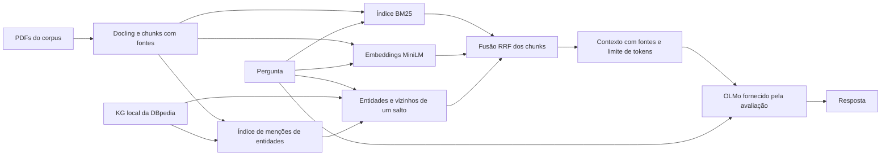

# Visão técnica do projeto

O sistema responde perguntas sobre IFMIF-DONES e artigos de IA usando evidências
extraídas de PDFs. A interface de submissão é
`answer(question, corpus_dir, model_id) -> str`, em [main.py](../src/main.py).

## Fluxo completo

## Implementações principais

| Parte | O que faz | Detalhes |
| --- | --- | --- |
| Documentos e geração | Extrai Markdown, cria chunks, preserva referências e monta o prompt | [Pipeline RAG](implementations/rag-pipeline.md) |
| Busca híbrida | Combina rankings BM25, semântico e KG usando RRF | [Pipeline RAG](implementations/rag-pipeline.md#recuperação-e-fusão) |
| Preparação da DBpedia | Converte os resultados dos notebooks para arquivos locais validados | [Preparação do KG](implementations/kg-data-preparation.md) |
| Exploração do grafo | Segue associações de um salto para recuperar chunks de entidades vizinhas | [Recuperação pelo grafo](implementations/graph-retrieval.md) |
| Testes e submissão | Valida componentes, executa diagnósticos e constrói o ZIP | [Build e validação](implementations/build-and-validation.md) |

## Como o grafo influencia a busca

O KG primeiro reconhece nomes equivalentes, como “Be7” e “Beryllium-7”. Agora
também consulta vizinhos da entidade e procura os chunks que mencionam esses
vizinhos. Os candidatos entram no terceiro ranking do RRF. Só são considerados
vizinhos encontrados no corpus, com limites de quantidade, grau e frequência.

O grafo orienta a recuperação; as passagens enviadas ao modelo continuam vindo
dos PDFs. Um `wikiPageWikiLink` é tratado como associação editorial, sem atribuir
causalidade ou equivalência à conexão.

| `KG_MODE` | Comportamento |
| --- | --- |
| `off` | BM25 + semântico |
| `mentions` | Acrescenta menções das entidades da pergunta |
| `graph` | Acrescenta menções e expansão limitada por vizinhos; padrão atual |

## Organização

- `src/`: código de inferência e build; `src/kg/` contém artefatos gerados.
- `notebooks/dbpedia/`: coleta offline e protótipos de pesquisa.
- `data/`: exportações originais recebidas do notebook.
- `tools/`: preparação e diagnóstico local.
- `tests/`: testes de índices, ranking, integração e integridade.
- `docs/implementations/`: descrição detalhada do código implementado.
- `docs/reports/`: resultados de diagnósticos; `docs/plans/`: planos de pesquisa.

## Restrições e estado da avaliação

O ambiente oficial usa uma H100, não possui internet e limita a execução total
a 60 minutos e o ZIP a 1 GB. O KG roda em CPU, sem outro modelo de linguagem ou
dependência adicional em inferência. Consulte os
[requisitos locais da competição](competition-requirements.md).

Há testes funcionais e um diagnóstico de expansão com o grafo real e chunks
sintéticos. Isso demonstra que as arestas influenciam o ranking, mas ainda não
mede ganho de acurácia, recall de evidências ou o tempo completo na H100.
Os próximos experimentos devem comparar os três modos no mesmo corpus.
