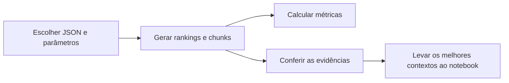

# Como testar a solução e ler os resultados

Este guia cobre os testes locais. Eles terminam nos rankings e **não carregam
o OLMo**. Para gerar respostas, use depois o notebook externo.



## 1. Executar um teste de recuperação

Use o preset das 25 perguntas com MiniLM e cinco variantes:

```bash
.venv/bin/python tools/run_retrieval.py \
  --config experiments/configs/public-25-minilm.json \
  --output experiments/runs/meu-teste-01
```

Escolha uma pasta nova a cada teste. O programa reaproveita PDFs processados e
embeddings em cache quando as configurações são compatíveis. Os modelos e PDFs
precisam estar disponíveis localmente.

O preset usa `embedding_device=auto`: CUDA quando disponível ao processo e CPU
como alternativa. O processamento de PDFs fica em CPU por padrão. Para exigir
GPU no embedding ou escolher CPU explicitamente:

```bash
# GPU obrigatória; encerra com mensagem se CUDA não estiver acessível:
.venv/bin/python tools/run_retrieval.py \
  --config experiments/configs/public-25-minilm.json \
  --embedding-device cuda --output experiments/runs/meu-teste-gpu

# Comparação controlada em CPU:
.venv/bin/python tools/run_retrieval.py \
  --config experiments/configs/public-25-minilm.json \
  --embedding-device cpu --output experiments/runs/meu-teste-cpu
```

Com embeddings em cache, não há nova codificação dos documentos: é normal
observar pouco uso da GPU. Apenas as consultas passam pelo encoder. BM25, KG,
fusão e o produto dos vetores NumPy continuam em CPU. O dispositivo pedido e
o efetivo aparecem no início do log e em `config.json`.

`--docling-device cuda` ativa GPU também na extração, quando ela for necessária.
O cache de extração distingue CPU e CUDA. Isso pode exigir processar novamente
os PDFs; para começar, mantenha Docling em CPU e altere somente o embedding.

## 2. Escolher o que comparar

Edite uma cópia do JSON ou acrescente flags. As flags prevalecem sobre o arquivo.

| Teste | Configuração/flag |
| --- | --- |
| Somente semântico | `--variants dense` |
| Somente BM25 | `--variants bm25` — não carrega o encoder |
| Semântico + BM25 | `--variants hybrid` |
| Híbrido + menções | `--variants mentions` |
| Híbrido + exploração do grafo | `--variants graph` |
| Semântico + KG, sem BM25 | `--variants dense_mentions dense_graph` |
| Peso lexical | `--dense-weight 1 --bm25-weight 0.5` |
| Peso do KG | `--kg-weight 0.25` |
| Constante RRF | `--rrf-k 10` — diferente do top-k e do k1 do BM25 |
| Quantidade de candidatos por canal | `--candidate-depth 100` |
| Quantidade final de chunks | `--top-k 10` |
| Stopwords/stemming | `--bm25-stopwords --bm25-stemming`, ou as flags `--no-*` |
| Parâmetros BM25 | `--bm25-k1 1.2 --bm25-b 0.75` |
| Continuidade por vizinhos | `--continuity` / `--no-continuity` |
| Penalização de capas/referências | `--penalize-metadata` / `--no-penalize-metadata` |
| Reconhecimento de fórmulas | `--formula-enrichment`, exige os pesos opcionais preparados |

Um canal com peso zero não constrói seu índice. Ao usar `dense`, o BM25 fica
desativado mesmo que seus parâmetros estejam no JSON. Usando apenas `bm25`,
não é necessário carregar o modelo de embedding. A etapa de geração fica fora
do runner de recuperação.

Comece alterando uma variável por vez, mantendo documentos, perguntas,
chunking e julgamentos iguais. O [guia detalhado](implementations/experiment-configuration.md)
também documenta a grade de pré-processamento, `k1` e `b` com `run_experiments.py`.

## 3. Calcular as métricas

O runner não calcula relevância automaticamente. Após a execução:

```bash
for variant in dense bm25 hybrid mentions graph; do
  .venv/bin/python tools/evaluate_retrieval.py \
    --input "experiments/runs/meu-teste-01/llm_inputs/${variant}.json" \
    --judgments experiments/judgments/public-25-2026-11-08.json \
    --k 1 3 5 10 \
    --output "experiments/runs/meu-teste-01/metrics-${variant}.json"
done
```

Inclua no laço somente as variantes que você executou. Guarde uma cópia dos
julgamentos usados quando for revisá-los; os resultados registram os hashes.

| Arquivo da execução | O que olhar |
| --- | --- |
| `config.json` | Parâmetros efetivos, dispositivos e versões |
| `summary.json` | Quantidade de PDFs/chunks e auditoria de truncamento |
| `timings.json` | Tempos e indicação de cache; cache hit não mede indexação fria |
| `llm_inputs/VARIANTE.json` | Perguntas, respostas esperadas e chunks completos para o notebook |
| `metrics-VARIANTE.json` | Métricas por pergunta e médias |
| `review.md` e `questions/` | Rankings e trechos para leitura |
| `judgments.csv` e `answerability.csv` | Espaços de revisão manual; não são preenchidos pela LLM |

`summary.json` mantém `quality_metrics=null`: as métricas calculadas à parte
estão em `metrics-*.json`. Em um teste só de BM25, `embedding_audit_performed`
é falso; os zeros de truncamento não representam uma auditoria do encoder.

## 4. Interpretar os resultados

- **nDCG:** mede a ordenação dos documentos de acordo com as notas 0, 1 e 2.
- **Recall nota 2:** mede quantos documentos diretamente relevantes apareceram.
- **Cobertura nos primeiros k chunks:** mede quais documentos entraram naquele
  orçamento de contexto, sem contar repetições do mesmo artigo.
- **Evidência suficiente:** exige ler se o fato, a fórmula ou o argumento
  necessário realmente está no trecho. O score documental não mede isso.

As notas são estimadas e revisáveis. A base tem 25 perguntas, mas 16, 18 e 21
não têm documento nota 2. Seu Recall estrito fica indefinido. Use também o
[resumo de cobertura](../data/local_eval/coverage.csv) para separar as 17
perguntas textuais dos casos parciais, visuais ou ambíguos.

Um exemplo concreto: na Q13, várias configurações têm nDCG documental 1 por
recuperarem o artigo certo, mas omitem a conclusão da prova. Na Q7, recuperar
o artigo sem a passagem de 500–600 °C não cobre toda a pergunta.

## 5. Resultados encontrados até agora

Nas cinco variantes com MiniLM, após a revisão dos negativos e a correção para
AI-027, os resultados foram:

| Variante | nDCG@10 — 25 perguntas | Recall nota 2 — 22 perguntas |
| --- | ---: | ---: |
| Denso | 0,8313 | 0,9318 |
| BM25 | 0,8064 | 0,9053 |
| Híbrido | 0,8769 | 0,9205 |
| Mentions | 0,8865 | 0,9129 |
| Graph | 0,8780 | 0,9129 |

Nos testes seguintes, reduzir o peso BM25 para 0,25 ou 0,5 não melhorou o
híbrido. Variar a constante RRF entre 0, 10, 30, 60 e 100 manteve **60** como
melhor nDCG dos dois finalistas. Menções com k=10 recuperam a conclusão da Q13,
mas ela fica na posição 10. São resultados locais de recuperação, não acurácia.

O controle recomendado para os próximos testes é **MiniLM + híbrido 1/1,
RRF k=60, sem KG**. Mentions com k=10 são uma comparação útil para geração.
Os relatórios preservam as condições de cada teste:

- [Comparação das cinco variantes](reports/all-versions-public25-2026-11-08.md)
- [Revisão dos julgamentos e pesos](reports/rrf-weights-public25-2026-11-08.md)
- [Constante do RRF](reports/rrf-k-public25-2026-11-08.md)
- [Resultados oficiais informados](reports/submission-results.md)

Pastas antigas em `experiments/runs/` podem ter sido removidas; os relatórios
preservam as medições registradas. Ao repetir um teste, gere uma pasta nova.

## 6. Gerar respostas e verificar o código

Para geração externa, leve `llm_inputs/VARIANTE.json` ao
[notebook de respostas](../notebooks/generation/olmo3_7b_answers.ipynb).
Use o mesmo prompt e parâmetros de geração ao comparar os contextos. A resposta
esperada serve à avaliação e não deve ser entregue à LLM como evidência.

Para testar o código sem modelos de resposta:

```bash
.venv/bin/python -m unittest discover -s tests -v
```

A submissão tem configuração própria em [`src/pipeline.json`](../src/pipeline.json).
Alterar um JSON de experimento não altera o ZIP. O preset MiniLM local também
não troca o encoder já existente em `src/embed_model`. A organização do código
e a precedência das configurações estão no [guia do pipeline](implementations/rag-pipeline.md).
