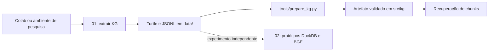

# Experimentos com a DBpedia

| Notebook | Nome anterior | Papel |
| --- | --- | --- |
| [01_extract_domain_kg.ipynb](01_extract_domain_kg.ipynb) | `dbpedia.ipynb` | Extrair o subgrafo via SPARQL e exportar Turtle/JSONL |
| [02_retrieval_prototypes.ipynb](02_retrieval_prototypes.ipynb) | `Untitled1.ipynb` | Experimentar recuperação por entidades, DuckDB, embeddings BGE e pontes |

Os notebooks foram movidos de `src/` e renomeados sem alteração das células ou
das saídas salvas. São artefatos de pesquisa; o código de submissão fica em `src/`.
As implementações atuais são descritas na [visão técnica](../../docs/technical-overview.md).

No Colab, execute o primeiro notebook e copie `domain_kg.ttl` e
`kg_rag_chunks.jsonl` para `data/` no repositório. Os notebooks usam caminhos
relativos ao diretório de execução. A célula do primeiro notebook que remove
`dbpedia_extraction_cache.sqlite` reinicia o cache; para continuar uma coleta,
preserve esse arquivo e não execute essa célula.

As consultas SPARQL usam rede e CPU. No segundo notebook, a GPU pode acelerar
os embeddings, mas os modelos BGE e bancos DuckDB desses protótipos não são
empacotados no pipeline atual. O protótipo `UnifiedCompetitionRAG` não contém
todo o fluxo de ingestão/geração da submissão.

Para converter os resultados existentes, siga a
[preparação do KG](../../docs/implementations/kg-data-preparation.md). Não é
necessário executar novamente os notebooks para ativar a expansão do grafo.
